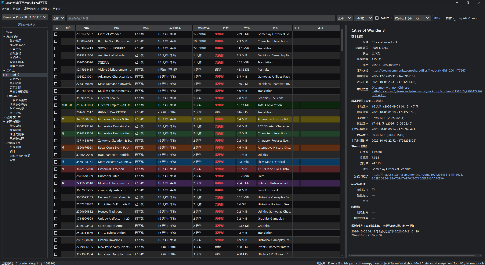
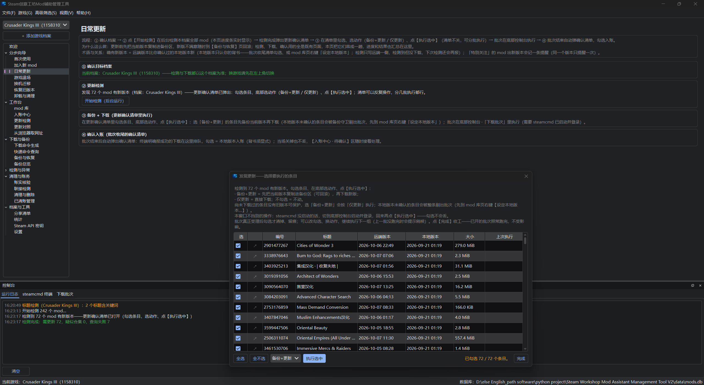
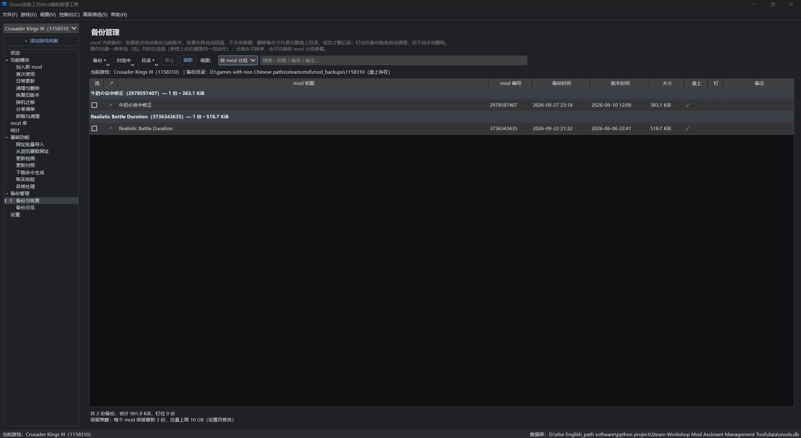
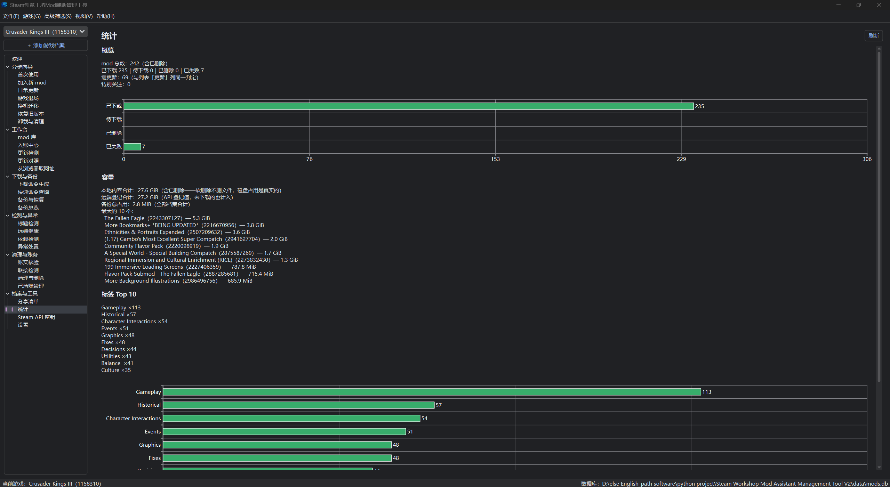

**English** | [中文](README.md)

# Steam Workshop Mod Assistant Management Tool

  
  
<b>Manage Steam Workshop mods day to day — without opening the Steam client.</b>

  
Windows 10/11 &amp; Linux · 中文 / English UI · Portable · Free &amp; Open Source

  

    
    
    
    
    
  

---

## What is this

A Windows &amp; Linux desktop tool for Steam players who use lots of Workshop mods: **run the whole daily routine without opening the Steam client**.

- **Information hub** — a local SQLite ledger tracks every mod's ID, status, version, update history, notes and tags;
- **Dispatcher** — queries Steam's official API for remote versions and drives the built-in steamcmd terminal to download;
- **Rollback-ready** — the old version is backed up automatically before every update; restore any time if the new one disappoints.

All downloads are carried out by the **official steamcmd inside a built-in terminal — fully visible, stoppable at any moment**: in manual mode you paste commands yourself; in batch mode the tool sends them one by one — only the ones you ticked, and a gentle stop never loses the queue. This tool never touches the Steam client, and **every version claim is confirmed by you personally** — steamcmd's output and the files on disk have no authority to write your ledger.

## How it works (three sentences)

1. **Check for updates** — ask Steam's official API for each mod's latest update time and compare it with **the local version you confirmed**: newer on the remote side → flagged "needs update";
2. **Download** — the selected mods are turned into official commands and executed in the built-in steamcmd terminal — pasted manually, or sent one by one by batch mode;
3. **Confirm** — downloads that steamcmd explicitly reports as successful enter a "pending confirmation" list; **only after you tick and confirm does the local version enter the ledger** — otherwise it waits in the Intake Center.

## Feature overview

**Update management**
- 🔍 Batch update check — remote vs. your confirmed local version, compared per mod, results bucketed for display
- 🔄 One-stop daily updates — check → tick &amp; confirm (optionally back up first) → batch download → closing confirmation list into the ledger
- 📥 Intake Center — tick pending items into the ledger; the "pending claims" area adopts mods downloaded by other front-ends or copied in by hand
- 📜 Update timeline — per-mod version history and snapshots

**Download execution**
- 🖥️ Built-in steamcmd terminal — real-time pseudo terminal; log in once, batches queue up automatically
- ⏯️ Batch download orchestration — gentle stop, queue survives disconnects, one-click rerun of failed items, auto-suspend when logged out
- 🧹 Pre-batch cache clearing — steamcmd's download cache is cleared before every batch (on by default, can be turned off)

**Data safety**
- 💾 Pre-update backups — the old version copied in full (multi-threaded), per-mod retention + global quota + pinned exemptions
- ♻️ One-click restore — a backup of the current version is forced first; every restore stays reversible
- 🧾 Ledger-vs-disk audit — a three-way diff ("in ledger / on disk / version match") with one-click repair commands for anomalies
- 🗑️ Soft delete &amp; full purge — soft delete is recoverable; full purge deletes physically and blacklists the ID, blocking steamcmd's "resurrection" assembly
- 🛡️ Three lines of anti-resurrection defense — the blacklist blocks registration + caches are cleared before batches + blacklisted entries are removed from steamcmd's ledger file on exit (with an automatic backup first)

**Multi-game &amp; migration**
- 🎮 Multi-game profiles — RimWorld / CK3 / any Workshop game, independent ledgers, one-click switching
- 🔗 Junction guide — bidirectional topology detection; the game can read downloads the moment they land
- 🚚 Machine migration — export ledger → move files → rebuild links, a seven-step guide
- 📋 List sharing — export your collection (notes / tags / watch flags) for others, one-click merge on their side

**Experience &amp; maintenance**
- 🌗 Dark theme, three states (follow system / dark / light), instant switching
- 🌍 Bilingual UI — 中文 / English, one click in Settings (applied after restart; startup dialogs follow the chosen language too)
- 📊 Statistics charts, advanced filters (ID / size / time / tag / author), color tags
- 🧰 Retired-mod handling — dead remote entries auto-archived; re-check / search / link replacement
- 🧹 Cleanup &amp; uninstall — the "uninstaller" for portable software: inventory, guidance, zero residue
- 🌐 Optional: grab Workshop URLs from your browser tabs in one click

## Design principles

- **Verdict-based ledger (the v2 core)** — local versions are written only through the "confirmation gate": the batch closing checklist, claim acceptance, and right-click manual setting — all three are human endorsement. Disk files and timestamps are never used to auto-derive versions
- **Trust only the terminal output** — a download's success or failure is judged by steamcmd's terminal output: explicitly reported success counts; the tool never guesses and never scans files into the ledger
- **Anti-resurrection, three lines of defense** — steamcmd's download cache can reassemble deleted mods onto disk (verified in the field). A full purge auto-blacklists the ID (blocking re-registration), caches are cleared before every batch (cutting the source), and blacklisted entries are removed from steamcmd's ledger file on exit (automatic backup before writing) — uprooted for good
- **Portable** — ledger, settings and logs all live inside the app's own folder; moving = copying the folder, uninstalling = deleting the folder
- **Self-documenting UI** — every button has a tooltip; every step says what it does, what failure means, and what comes next
- **steamcmd is not bundled** — guided download from Valve's official site (its self-updating mechanism, licensing considerations, and fewer antivirus false positives)

## Getting started

**Windows**

1. Grab the Windows portable zip from the latest [Release](https://github.com/sefrawe/Steam-Workshop-Mod-Assistant-Management-Tool/releases) assets
2. Extract into any **normal folder** (not Program Files) — no installation
3. Run `Steam Workshop Mod Assistant Management Tool V2.exe`
4. Follow the first-use wizard: locate steamcmd → create a game profile → link the game's mod directory → adopt existing mods

**Linux (AppImage)**

1. Grab `linux-packages.zip` from the latest Release and extract the `.AppImage`
2. `chmod +x` it and run; data lives in `~/.local/share/SteamWorkshopTool/`
3. Environment setup and troubleshooting: [docs/Linux环境准备.md](docs/Linux环境准备.md) (Chinese)

**First run on Windows**: the exe is unsigned (open-source and free; a code-signing certificate is planned), so SmartScreen may show "Windows protected your PC" — click **More info → Run anyway**. See the FAQ below for antivirus notes.

**Usage notes**:

- Download steamcmd from [Valve's official page](https://developer.valvesoftware.com/wiki/SteamCMD) and put it in an empty folder with an **English-only path**
- For games managed by this tool, **do not also subscribe to the same mods in the Steam client** — the two sides keep separate ledgers that know nothing of each other, and versions drift
- **Entrust one game's mods to exactly one tool**: co-managing the same game with RimSort or other steamcmd front-ends causes tug-of-war — it will re-download mods this tool deleted, nag updates by its own records, and versions will seesaw. Different games side by side are fine
- steamcmd and the Steam client are single-sign-on: logging into steamcmd kicks the client offline — normal
- Use English commands in the terminal

## Tech stack

| | |
|---|---|
| GUI | PySide6 (Qt 6) |
| Terminal | pywinpty (Windows ConPTY) / pexpect (Linux PTY) |
| Storage | SQLite (WAL) + JSON config |
| Networking | requests + truststore (system certificate store) |
| Backup | robocopy (Windows) / copytree (Linux) |
| Logging | loguru (optional, degrades gracefully if missing) |
| Packaging | PyInstaller (Windows exe / Linux AppImage) |

## FAQ

**Q: Do I need a Steam account?**
Downloads require an account that owns the game (steamcmd caches the login locally after the first login).

**Q: Which games are supported?**
Any Steam game with a Workshop.

**Q: Where is my data stored? Is anything uploaded?**
Windows: entirely inside the app folder (`data\`, `config\`); Linux AppImage: `~/.local/share/SteamWorkshopTool/`. Nothing is uploaded; update checks only **read** public information from Steam's official API.

**Q: Does it conflict with Steam client subscriptions?**
This tool downloads independently via steamcmd. Do not manage or subscribe to the same mod on both sides (see usage notes).

**Q: Can it coexist with RimSort and other managers?**
The tools can coexist, but **do not let two of them manage the same game**: each keeps its own list and version records, blind to the other — deleted mods come back, update nagging seesaws. Different games, no problem.

**Q: Why do deleted mods reappear?**
steamcmd's download cache reassembles them onto disk. Three defenses are on by default: a full purge auto-blacklists (blocking registration), caches are cleared before every batch, and blacklisted entries are removed from steamcmd's ledger file on exit. If the mod lives in another tool's list, remove it there first.

**Q: "Program is already running"?**
The tool keeps a single-instance lock: one window per generation (so two windows never drive the same steamcmd or write the same ledger). Switch to the window that is already open. Versions up to v2.1.0 predate this lock and cannot be seen by the current one — while both exist, never run download batches in both.

## License

[MIT](LICENSE) © sefrawe

A personal open-source project, not affiliated with Valve. Steam © Valve Corporation.
