# Mod管理工具使用文档

> 对象软件:Steam Workshop Mod Assistant Management Tool **V2**(判决制版,`main.py` 版本线 2.0.4)
> 文档性质:使用文档 + 源码导读。所有代码片段均摘自 `参考资料\源码已排除不必要文件\` 下的真实源码并标注 `文件路径:行号`;除中文标点统一转半角便于排版外,不改写任何代码(成稿后已用脚本逐行比对源文件校验)。
> 注释只解释**为什么这么写**(设计动机、红线约束、踩坑来源),不逐行翻译代码。

---

## 目录

- [一、软件定位](#一软件定位)
- [二、环境准备](#二环境准备)
- [三、各模块详解](#三各模块详解)
  - [3.1 启动与绿色便携地基](#31-启动与绿色便携地基)
  - [3.2 判决制账本(数据层)](#32-判决制账本数据层)
  - [3.3 网址解析与命令生成](#33-网址解析与命令生成)
  - [3.4 Steam 官方接口客户端](#34-steam-官方接口客户端)
  - [3.5 内置终端与下载判决](#35-内置终端与下载判决)
  - [3.6 入账中心(登记/确认/认领/盘点)](#36-入账中心登记确认认领盘点)
  - [3.7 更新检测与异常分类](#37-更新检测与异常分类)
  - [3.8 备份与恢复](#38-备份与恢复)
  - [3.9 删除体系与防复活](#39-删除体系与防复活)
  - [3.10 账实核验与连接巡检](#310-账实核验与连接巡检)
  - [3.11 导入导出与旧账迁移](#311-导入导出与旧账迁移)
  - [3.12 mod 描述与翻译](#312-mod-描述与翻译)
- [四、常见问题](#四常见问题)
- [五、附录:总架构 mermaid 图](#五附录总架构-mermaid-图)

---

# 一、软件定位

**一句话:不打开 Steam 客户端,完成创意工坊 mod 的日常管理。**

`readme.md:20-24` 给出的三层定位,也是理解全部源码的钥匙:

1. **信息中枢** —— 本地 SQLite 账本登记每个 mod 的编号、状态、版本、更新历史、备注与标记;
2. **调度器** —— 向 Steam 官方接口查询远端版本,指挥内置的 steamcmd 终端完成下载;
3. **可回滚** —— 更新前自动备份旧版本,新版不满意随时恢复。

## 1.1 V2 的本质变化:判决制

V2 不是 V1 的界面翻新,而是一次"记账权收回"重构。项目计划书(`项目文件夹/2号项目记事本.md:9-12`)用三句话说清了为什么重构:

> acf 是 steamcmd 内部状态机的快照,在失败形态会说谎:超时部分落盘(Installed 三件套刷新而 content 半残)、"双账分裂"(干净失败时 Details 指向尝试过的新版)、毒 mod 缓存装配复活。**终端输出不撒谎**——Success/Timeout 逐条供述。重构 = 让终端判决成为唯一票据来源,人勾选确认后才写入本地记录;检测、扫描、任何自动链路都拿不到写入权。

三句核心架构(全文反复出现,先立在此处):

| # | 架构句 | 含义 |
|---|---|---|
| 1 | **判定公式** `API time_updated > confirmed_version` | 需不需要更新,只比较"远端观测值"与"你确认过的本地版本";acf 从判定公式中退场 |
| 2 | **本地记录唯一写入者 = 确认门** | 票据 = 终端 SUCCESS 判决;下载完成只产生"待确认"队列行,**人勾选之后**才写进账本 |
| 3 | **acf 降级两用途** | 只做盘面清单(备份/清理/认领线索)+ 断根毒 mod(条目移除);绝不做版本判定 |

## 1.2 两条硬红线(贯穿全文)

源码注释里反复出现的 R17/R18 是判决制的两根支柱,先在此立牌:

- **R17(写入权)**:本地版本三件套(`confirmed_version / confirmed_at / confirmed_source`)只许"确认门"写——`confirm_items` / `claim_accept` / `set_manual_version` 三个正门;检测、扫描、批查等一切自动链路只写远端侧。
- **R18(写入值)**:`version_written` 要么等于"触发值"(你点下载时看到的远端版本号),要么为 NULL(版本未知)——**写入值永不高估**。

## 1.3 界面形态

- IDE 式布局:左侧导航 + 主功能区 + 底部 steamcmd 内置终端;
- 双通道:功能模块引导卡(逐步卡片)+ 基础功能直达页;
- 多游戏档案(RimWorld / CK3 / 任意创意工坊游戏),中文界面,绿色便携(数据全在程序旁)。

## 1.4 技术栈

| 用途 | 技术 | 出处 |
|---|---|---|
| GUI | PySide6(Qt 6) | `requirements.txt` |
| 终端 | pywinpty(ConPTY 伪终端) | `gui/terminalDock.py` |
| 存储 | sqlite3(WAL)+ JSON 配置 | `core/schema.sql`、`core/appSettings.py` |
| 网络 | requests + truststore(系统证书库) | `core/steamApiClient.py:55` |
| 备份引擎 | robocopy(/MT /XJ) | `core/backupManager.py` |
| VDF 解析 | vdf 库(断根手术用) | `core/steamPaths.py:471` |
| 翻译 | Edge 免鉴权通道(urllib) | `core/translateProvider.py` |
| 打包 | PyInstaller(--onedir --console) | `项目文件夹/2号项目记事本.md:949` |

---

# 二、环境准备

## 2.1 两种运行形态

| 形态 | 获取方式 | 数据落点 |
|---|---|---|
| **exe(日常推荐)** | GitHub Releases 下载 zip,解压即用 | exe 所在文件夹旁的 `data\`、`config\` |
| **源码运行** | Python 3.12+,`pip install -r requirements.txt`,`python main.py` | 项目根目录下的 `data\`、`config\` |

为什么源码形态的数据根是"core/ 的上一级",而打包形态是"exe 旁边"——`core/appPaths.py:5-16` 的文件头注释写得很直白(摘录):

> 打包运行(PyInstaller 出的 exe):数据根 = exe 所在的文件夹。账本、设置跟着软件走:整个文件夹拷去别的机器,数据原样带走——这就是"便携"的含义。为什么不能用程序文件所在的位置:单文件版 exe 每次启动把自己解压到临时目录、退出就删,数据写进去等于每次清零。

## 2.2 环境清单

1. **steamcmd**:从 Valve 官方下载(`developer.valvesoftware.com/wiki/SteamCMD`),放入**纯英文路径**的空文件夹;本工具刻意不内置它(自更新机制 + 许可考虑 + 减少杀软误报,`readme.md:85`)。
2. **Steam 账号**:下载需要拥有该游戏的账号;在设置页填一次登录命令(如 `login 你的账号`),steamcmd 登录一次后本机缓存。
3. **首次使用向导四步**(`gui/firstUsePage.py` 引导):定位 steamcmd → 建立游戏档案 → 接通游戏目录(junction)→ 纳入客户端已有 mod。

## 2.3 数据目录结构

```
软件文件夹\
├─ Steam Workshop Mod Assistant Management Tool V2.exe   (或 main.py)
├─ data\
│   ├─ mods.db                ← SQLite 账本(WAL 模式)
│   └─ mods.db.bak_*          ← 账本滚动备份(默认留 3 份)
├─ config\
│   ├─ GlobalSettings.json    ← 全局设置(原子写入)
│   └─ sefrawe\*.ini          ← 会话记忆(列宽/折叠/面板显隐)
└─ icon\                      ← 只读资源
```

账本、设置、会话记忆三层全部锁在软件文件夹内,是"搬家 = 拷文件夹,卸载 = 删文件夹"的机制本体。

## 2.4 启动序列

`main.py:3-9` 的文件头自述了启动顺序的设计理由。整条链画成图:

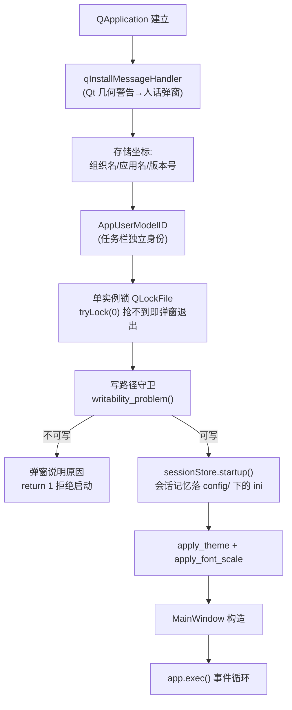

两处顺序为什么不能颠倒,`main.py` 的注释给了答案:

- **单实例锁必须在守卫之前**(`main.py:6-8`):"双开虽有 WAL + 事务兜底不至于写坏账,但两边各开各的 steamcmd、各自指挥下载,只会互相干扰——锁住比兜底好。"
- **写路径守卫必须在主窗口之前**(`main.py:11-15`):"主窗口一构造就会读配置、开数据库,数据目录写不了(典型:软件被放进 Program Files 这类系统目录)晚一步就是带着'随时写丢数据'的隐患继续跑。先探测,探不过弹窗说明原因、直接退出——**不静默把数据挪去别处**。"

---

# 三、各模块详解

## 3.1 启动与绿色便携地基

### 功能说明

这一组模块回答"软件从哪来、数据放哪、记忆存哪"三个地基问题:

- `main.py` —— 启动序列编排(单实例锁、写路径守卫、会话落点);
- `core/appPaths.py` —— 全项目"数据放哪"的唯一回答者(单源点);
- `core/appSettings.py` —— `config/GlobalSettings.json` 的读写封装,程序内唯一配置入口;
- `gui/sessionStore.py` —— 会话记忆(QSettings)从注册表搬进软件文件夹;
- `gui/theme.py` —— 深浅主题三态 + 全局字号缩放(两把同源尺子)。

### 代码片段与逐段注释

**片段① 单实例锁 + 写路径守卫 —— `main.py:99-116`**

```python
    # ---- R12 单实例锁:赶在守卫与主窗口之前 ----
    # tryLock(0) = 不等待,抢不到立刻报;锁对象必须活到程序退出
    # (main 函数局部变量正好如此),中途被回收等于没锁
    lock = QLockFile(_LOCK_PATH)
    if not lock.tryLock(0):
        QMessageBox.information(
            None, "程序已在运行",
            "本工具(V2)已有另一个窗口在运行(可能最小化在任务栏)。\n\n"
            "请切换到那个窗口使用——同时开两个会互相干扰"
            "(两边同时指挥 steamcmd、同时写同一本账)。")
        return 0

    # ---- T17 写路径守卫:必须赶在 AppSettings / 数据库之前 ----
    # 弹窗需要 QApplication 已存在,所以顺序是:建 app → 守卫 → 其余
    problem = appPaths.writability_problem()
    if problem is not None:
        QMessageBox.critical(None, "无法启动:数据目录不可写", problem)
        return 1
```

**为什么这么写**:

- 锁文件名带 `V2` 代际特征(`main.py:34-36` 的 `_LOCK_PATH`)——V1/V2 并存期要能同时开着对照,同一代内部才互斥;锁放在 `QDir.temp()`,不给用户文件夹添垃圾。
- `tryLock(0)` 用零超时:双开是用户误操作,不需要"等待另一个实例退出"这种语义,立刻报错立刻走。
- 锁对象是 `main()` 的局部变量,活到程序退出——注释特意点破"中途被回收等于没锁":Qt 的锁对象被 Python GC 回收后守卫就没了,这是最常见的错误写法。
- 守卫"真刀真枪"探测而非猜测权限(见片段②),因为它给出的结论要直接决定"拒绝启动"——宁可误报一次,不可带着丢数据的隐患继续跑。

**片段② 数据根定位 + 写路径探测 —— `core/appPaths.py:29-42` 与 `core/appPaths.py:74-103`**

```python
def app_root() -> Path:
    """程序的家目录:源码运行 = 项目根;打包运行 = exe 所在文件夹。"""
    if getattr(sys, "frozen", False):
        # PyInstaller 打包后:sys.executable 就是用户双击的那个 exe。
        # 注意不能用 __file__——打包后它指向解包出来的临时/内部目录,
        # 数据写到那里会丢(见文件头说明)
        return Path(sys.executable).resolve().parent
    # 源码运行:本文件在 core/ 里,上一级就是项目根
    return Path(__file__).resolve().parent.parent


def data_dir() -> Path:
    """数据目录:账本数据库(mods.db)和它的滚动备份都住这里。"""
    return app_root() / "data"
```

```python
def writability_problem() -> str | None:
    """启动守卫(T17):探测数据/配置目录能不能创建、能不能写入。
    能 → 返回 None(放行);不能 → 返回一段可直接弹窗的中文说明。
    探测是真刀真枪的:建目录、写一个几字节的小文件、随手删掉——
    毫秒级,比任何"猜权限"的写法都可靠。
    """
    for d in (data_dir(), config_dir()):
        try:
            d.mkdir(parents=True, exist_ok=True)
            probe = d / ".write_probe"
            probe.write_text("ok", encoding="utf-8")
            try:
                probe.unlink()
            except OSError:
                pass  # 写得进但删不掉也算可写;小文件留着无害,
                      # 不为这个误报"不可写"把用户拦在门外
        except OSError as exc:
            # 典型场景:软件被放进 Program Files 等系统目录,
            # 普通权限的进程没有写盘资格
            return (
                "程序无法在当前位置保存数据(账本、设置等将无处可写),"
                "因此拒绝启动。\n\n"
                f"出问题的目录:{d}\n"
                f"系统原因:{exc}\n\n"
                "解决办法:把整个软件文件夹移动到一个普通文件夹"
                "(例如 D:\\SteamModTool),\n"
                "不要放在 Program Files、Windows 等系统目录里,"
                "然后重新运行。"
            )
    return None
```

**为什么这么写**:

- `sys.frozen` 分支判断是 PyInstaller 的标准姿势,但注释强调的是**为什么不能用 `__file__`**:打包后 `__file__` 指向解包临时目录,数据写到那里每次启动都被清零。这一行注释是在防"好心简化"。
- 探测用"建目录 + 写探针文件"的真实 IO,而不是检查 ACL/组成员——Windows 权限组合太多,猜不如测;毫秒级成本换确定性。
- "写得进但删不掉也算可写"是个宽容分界:删除失败不影响数据安全,误拦用户才是大错——两害相权取其轻。
- 返回值是一段**可直接弹窗的中文说明**而不是布尔值:错误信息在发生地就地组织好,调用方零转译;这正是"core 层的错误串可以直接抵达用户"的项目约定。

**片段③ 设置的原子读写 —— `core/appSettings.py:110-133` 与 `core/appSettings.py:151-157`**

```python
    def load(self) -> None:
        if not self._path.exists():
            return
        try:
            raw = json.loads(self._path.read_text(encoding="utf-8"))
            if not isinstance(raw, dict):
                raise ValueError
        except (json.JSONDecodeError, OSError, UnicodeDecodeError, ValueError):
            self._backup_broken()
            self._data = dict(DEFAULTS)
            return
        merged = dict(DEFAULTS)
        for key, value in raw.items():
            if isinstance(value, bool):  # 先排除 bool(bool 是 int 子类)
                continue
            if isinstance(value, (int, float)):  # 手写 JSON 直接写数字也接受
                value = str(value)
            if isinstance(value, str):
                merged[key] = value
        # 密钥不落地(用户拍板):旧版本可能已在文件里存过 key——
        # 内存里就地抹掉,下次 save() 时文件里那行也随之消失
        merged.pop("steam_api_key", None)

        self._data = merged
```

```python
    def save(self) -> None:
        self._path.parent.mkdir(parents=True, exist_ok=True)
        tmp = self._path.with_suffix(".json.tmp")
        tmp.write_text(
            json.dumps(self._data, ensure_ascii=False, indent=2),
            encoding="utf-8")
        tmp.replace(self._path)  # 同盘替换是原子的
```

**为什么这么写**:

- **数字一律存字符串**是这个模块最反直觉的约定(文件头 `appSettings.py:11-17` 解释):如果混入数字类型,会出现"手改 JSON 生效、从界面保存一遍后字段消失"的诡异行为——因为 load 以字符串为口径合并,数字键会在界面保存时被 DEFAULTS 的字符串版覆盖回默认。统一字符串后,`get_int()` 转不动就回默认,手改 JSON 打错字也不崩。
- `bool` 先于 `int` 排除是 Python 的坑:`True` 是 `int` 的子类,不先排除会被转成 `"1"`。
- **起底合并**(`merged = dict(DEFAULTS)` 再覆盖):新版本加的键在旧配置文件里天然有默认值,"键恒在"让消费方不必写"键不存在回退默认"的分支。
- 保存用 **临时文件 + `replace()`**:同盘替换是原子操作,断电最多丢一次保存,不会留下半截 JSON;损坏文件另存 `.bak` 再回默认,用户的旧配置永远有尸可检。

**片段④ 会话记忆落进文件夹 —— `gui/sessionStore.py:52-63`**

```python
    def startup() -> int:
        """进程级落点切换 + 注册表旧键一次性迁移。返回迁移条数。

        必须在任何窗口(以及任何 QSettings())构造之前调用——落点
        设置只影响之后构造的 QSettings。幂等:重复调用安全。
        """
        global _last_migrated
        QSettings.setDefaultFormat(QSettings.Format.IniFormat)
        QSettings.setPath(QSettings.Format.IniFormat,
                          QSettings.Scope.UserScope, str(config_dir()))
        _last_migrated = migrate_from_registry()
        return _last_migrated
```

**为什么这么写**:

- Qt 在 Windows 上默认把 QSettings 写进注册表——这与"绿色软件"直接冲突(文件夹删干净了注册表还留着记忆)。`setDefaultFormat + setPath` 是**进程级静态设置**,改一次全项目的无参 `QSettings()` 全部透明生效,既有代码一行不用改。
- 迁移幂等且保守(`sessionStore.py:80-81`):"会话文件已有内容时不搬不覆盖",且**不删注册表原稿**——回程票是"删掉文件夹内的会话文件再重启"。

**片段⑤ 全局字号缩放的两把同源尺 —— `gui/theme.py:139-155`**

```python
    def apply_font_scale(app) -> None:
        """全局字号缩放:main.py 在主窗口构造之前调用(布局度量随全局
        字体走)。只影响没写样式表的控件——菜单/树/表格/按钮/大多数
        正文;样式表写死 font-size 的标签由 font_px() 接管。"""
        scale = _font_scale()
        if scale == 1.0:
            return
        f = app.font()
        f.setPointSizeF(f.pointSizeF() * scale)
        app.setFont(f)


    def font_px(base: int) -> int:
        """样式表字号换算:页面里写死的 font-size 一律用它现算,例:
        setStyleSheet(f"font-size: {font_px(18)}px; ...")
        页面构造发生在启动时,值与全局字体同刻同源。"""
        return max(1, round(base * _font_scale()))
```

**为什么这么写**:

- 字号缩放有两条路:Qt 全局字体(影响无样式表控件)与 QSS `font-size`(样式表优先级更高)。如果两条路各读各的配置,缩放会出现两套值;所以 `_font_scale()` **读一次就缓存**(`theme.py:124-126` 注释:"全局字体与样式表字号必须同一把尺,中途改文件也不许两套值"),`apply_font_scale` 与 `font_px` 共享同一缓存。
- 缩放必须在主窗口构造**之前**应用:布局度量随全局字体走,后改字体的结果是"字大了、布局还是按旧字号算的"。

### 执行逻辑流程图

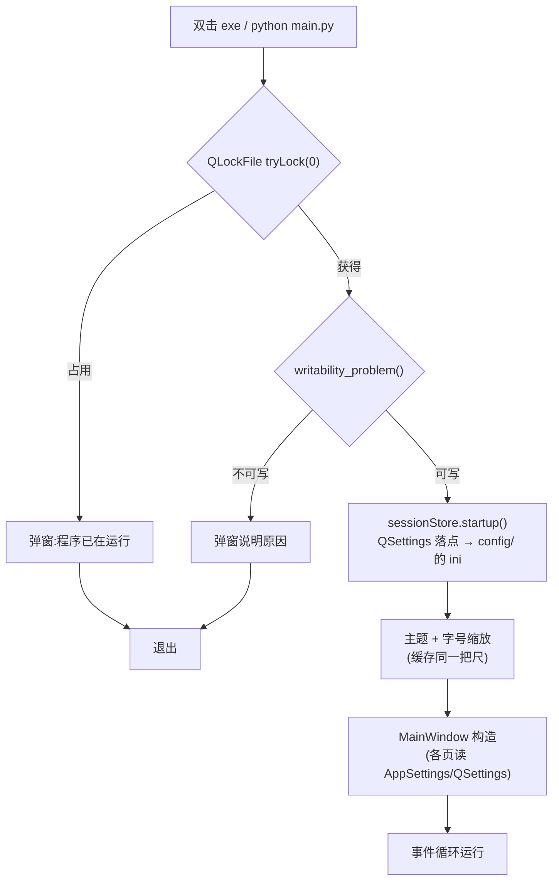

---

## 3.2 判决制账本(数据层)

### 功能说明

数据层由四件构成:

| 件 | 职责 |
|---|---|
| `core/schema.sql` | 11 张表 + 三条全局约定(user_version=1 新世系) |
| `core/models.py` | dataclass 模型层,GUI 永远不碰 0/1 和 JSON 字符串 |
| `core/modRepository.py` | 抽象契约(ABC):上层只认接口 |
| `core/sqliteRepository.py` | 唯一实现;**确认门(confirm_items)住在这里** |

`mods` 表是判定公式的载体;`verdict_log` 是判决制的中枢——**一张表双角色**。

### 代码片段与逐段注释

**片段① mods 表:确认三件套与禁区 —— `core/schema.sql:35-57`(节选)**

```sql
CREATE TABLE mods (
                      mod_id INTEGER PRIMARY KEY,
                      game_id INTEGER NOT NULL REFERENCES games(app_id) ON DELETE RESTRICT,
                      status TEXT NOT NULL DEFAULT 'tracked'
                          CHECK (status IN ('tracked','downloaded','deleted','failed')),
                      url TEXT,                          -- 工坊页面;urlParser 单源可现拼
                      title TEXT,
                      creator TEXT,                      -- 作者 SteamID64
                      time_created INTEGER,
                      time_updated INTEGER,              -- ★远端观测(检测三路写库)
                      last_time_updated INTEGER,         -- 上次远端观测(快照分母 + 提醒去重)
    -- ★ 本地确认基准三件套(R17:只许确认门写)
                      confirmed_version INTEGER,         -- NULL = 未确认 / 版本未知(备份守卫拒绝)
                      confirmed_at INTEGER,
                      confirmed_source TEXT
                          CHECK (confirmed_source IN ('verified','unverified','inherited_acf','claim','manual')),
                      local_size INTEGER,                -- 可选,只读盘点回填(D23);不参与版本判定(R19)
                      file_size INTEGER,
```

**为什么这么写**:

- 与 V1 的结构差异本身就是判决制宣言(文件头 `schema.sql:12-14`):"*mods 表不再有 local_timeupdated / manifest——本地版本基准 = confirmed_version,唯一写入点 = 确认门;acf 从判定公式退场*"。把旧的本地列从 schema 里物理删掉,比加代码守卫更彻底——想自动写也没地方写。
- `confirmed_source` 用 CHECK 约束五个合法来源:每一个都是一种**人工背书形态**(verified=终端 SUCCESS 判决、unverified=批查失败照常确认、inherited_acf=旧账迁移、claim=盘面认领、manual=手动设定)。来源随版本一起记录,是"灰显弱化"显示逻辑的依据(`core/constants.py:31-38`)。
- `local_size` 的注释直接写死 R19:"不参与版本判定"——大小是磁盘事实,与版本无关,混进判定公式只会制造误报。

**片段② verdict_log:一张表双角色 —— `core/schema.sql:90-115`**

```sql
-- ------------------------------------------------------------
-- verdict_log 判决史 + 确认队列,一张表双角色(§二):
-- pending = confirmed_at IS NULL 的 success/claim/manual 行 → 确认队列(重启不丢)
--   确认 = 填 confirmed_at + 写 mods.confirmed_version(confirm_items 正门)
--   修剪(D23):非确认行按 mod 保留最近 verdict_keep 条或 90 天;
--   确认行随 mod 生命周期保留——它是当前 confirmed_version 的票据
-- mod_id 刻意无外键:待确认条目可能尚未入账(D39),继承 failed_mods 先例
-- ------------------------------------------------------------
CREATE TABLE verdict_log (
                             id INTEGER PRIMARY KEY,
                             mod_id INTEGER NOT NULL,
                             game_id INTEGER NOT NULL,          -- C 级提案①:批次/认领归属档案(冗余存档,无外键)
                             kind TEXT NOT NULL
                                 CHECK (kind IN ('success','timeout','fail','claim','manual')),  -- C 级提案②
                             version_trigger INTEGER,           -- 触发值(D3 两来源)
                             version_query INTEGER,             -- 收尾批查现场值(D4)
                             version_written INTEGER,           -- 实际写入 confirmed_version 的值(D4 分支结果)
                             title TEXT,                        -- D39:落 pending 顺手存,离线可显
                             file_size INTEGER,                 -- D39:同上;确认未登记 mod 有据可建行
                             source TEXT,                       -- 写入 mods.confirmed_source 的值
                             confirmed_at INTEGER,              -- NULL = 待确认
                             occurred_at INTEGER NOT NULL DEFAULT (CAST(strftime('%s','now') AS INTEGER)),
                             note TEXT
);
```

**为什么这么写**:

- **pending 用 `confirmed_at IS NULL` 表达而不是单独一张队列表**:待确认队列天然就是"还没盖章的判决行",一张表两个角色(史 + 队列),重启不丢、修剪规则只对未确认行生效。确认行永不删——它是当前 `confirmed_version` 的"票据",删了票据,账上的版本就成了无源之水。
- `version_trigger / version_query / version_written` 三个版本号并列存档,是 R18 的**证据链**:写入值要么等于触发值要么为 NULL,批查现场值无论成败都留档——"哪天要对账,原始证据都在"。
- `mod_id` 刻意无外键:快速命令下载的东西可能根本不在账上(D39),判决行要先于 mod 行存在,等确认时才建行。有外键反而做不到这件事。
- `title / file_size` 落 pending 时顺手存:确认弹窗在离线状态也有东西可显示,确认建行时也有据可依。

**片段③ Verdict 模型与"版本未知"单源 —— `core/models.py:72-78` 与 `core/models.py:90-107`**

```python
    @property
    def version_unknown(self) -> bool:
        """版本未知:没有已确认的本地版本(confirmed_version IS NULL)。
        单源约定沿旧版:备份守卫拒绝、更新判定分桶、库页显示三处都从这里取。
        判定公式(D2)只对 downloaded 且非版本未知条目生效;
        版本未知条目进更新对照/详情按「版本未知」态显示。"""
        return self.confirmed_version is None
```

```python
@dataclass
class Verdict:
    """verdict_log 一行:判决史 + 确认队列双角色。
    confirmed_at=None 即 pending(待确认队列行,重启不丢)。
    mod 可能不在 mods 表(D39)——title/file_size 落 pending 时顺手存,离线可显。"""
    mod_id: int
    kind: str                          # success/timeout/fail/claim/manual
    game_id: int                       # 归属档案(冗余存档,无外键)
    version_trigger: int | None = None
    version_query: int | None = None
    version_written: int | None = None
    title: str | None = None
    file_size: int | None = None
    source: str | None = None
    confirmed_at: int | None = None
    occurred_at: int | None = None
    note: str | None = None
    id: int | None = None
```

**为什么这么写**:

- `version_unknown` 是一个小到容易被忽视的 property,但它是**三处消费方共用的单源**:备份守卫靠它拒绝、检测分桶靠它给"版本未知"态、库页显示靠它。若三处各写一遍 `confirmed_version is None`,口径迟早走样。
- models 层的文件头(`models.py:10-13`)写明边界约定:"dataclass 里用 Python 的自然类型(bool / list / dict),存储格式(INTEGER 0/1、JSON 文本)与自然类型的互相转换一律由 sqliteRepository 在读写边界完成,GUI 层永远不碰 0/1 和 JSON 字符串"——转换成本集中一处,换来的全部消费方零心智负担。

**片段④ 开库三分支:拿错库要大声说清 —— `core/sqliteRepository.py:112-142`**

```python
        # ---- 开库三分支:空库建表 / 新世系 v1 直接开 / 其余拒绝 ----
        version = self._conn.execute("PRAGMA user_version").fetchone()[0]
        if version == 0:
            # 空库 → 跑 schema.sql 建表(脚本自己会把 user_version 置 1)。
            # 幂等:重复打开同一个空库不报错,测试里可以随便造临时库
            schema = (Path(__file__).parent / "schema.sql").read_text(
                encoding="utf-8")
            self._conn.executescript(schema)
        elif version == 1:
            # v1 有两种可能:本工具的新世系库,或上一代工具的旧库
            # (旧版 user_version 同样从 1 起步)。用标记表鉴别:
            # 新世系必有 verdict_log,旧库没有。拿错库要大声说清,
            # 绝不开着错的库继续跑(否则查询会以更难懂的方式炸)。
            marker = self._conn.execute(
                "SELECT 1 FROM sqlite_master WHERE type='table' AND name=?",
                (_NEW_WORLD_MARKER_TABLE,)).fetchone()
            if marker is None:
                raise ValueError(
                    f"{self._path} 是上一代工具的旧账本:请到"
                    "「换机迁移」页先做一次旧账迁移,把旧数据搬进新库;"
                    "不要让新旧两代工具指向同一个数据库文件")
        else:
            # 版本号比本工具认识的新(或旧世系 v2/v3)——都读不懂,拒绝。
            # 显式爆炸好过静默错读(约定 3)
            raise ValueError(
                f"{self._path} 的数据库结构版本(v{version})本工具读不懂:"
                "旧世系库请走「换机迁移」的旧账迁移;更新版本的库请先"
                "升级本工具再打开")
```

**为什么这么写**:

- 两代工具的 `user_version` 都从 1 起步,光看版本号分不清新旧世系;所以用 `verdict_log` 表的存在性当"新世界标记表"。这是一个低成本、不可伪造的世代指纹。
- 连接参数也有讲究(`sqliteRepository.py:102-109`):`isolation_level=None` 自动提交 + `check_same_thread=False`(账本连接允许跨线程,BackupManager 先例)、每个连接重开 `foreign_keys`(连接级属性,schema.sql 里那条只管建表期)、`busy_timeout=5000`(别的程序开着库时先等 5 秒而不是立刻炸)。

**片段⑤ 确认门主入口 —— `core/sqliteRepository.py:977-1056`**

```python
    def confirm_items(self, mod_ids: list[int]) -> int:
        """★确认门主入口:把入账中心勾选的条目批量确认,返回确认条数。
        一个事务,逐条做四件事:
        1. 找该 mod 最新一条未确认的 success/claim/manual 判决行——
           没有 = 没东西可确认(已确认过 / 从没跑过批次)→ 报错;
        2. 黑名单拦截(D11):名单内的编号绝不自动建行;
        3. mods 有行 → 更新确认三件套,tracked/failed → downloaded
          (deleted 拒绝,请先恢复);没行 → 用判决行上顺手存的
           game_id/title/file_size 建行(D39:快速命令下载的东西
           账上本来没有);
        4. 该 mod 全部未确认的 success/claim/manual 行盖"已确认"戳
          (排队里的旧批次一并销账,队列不留过期重复项)。
        版本号与来源直接取判决行上已写好的值——GUI 只做"背书",没有
        第二次填数字的机会,写入值永不高估(R18)由结构保证。
        幂等口径:同一批重复确认 → 第二次报错(队列里已没有它的行),
        账面状态不变;部分失败整体回滚,绝不留半截确认。"""
        ids = list(dict.fromkeys(int(i) for i in mod_ids))  # 去重保序
        if not ids:
            return 0
        confirmed = 0
        marks = ",".join("?" * len(_QUEUE_KINDS))
        with self._atomic():
            for mod_id in ids:
                row = self._conn.execute(
                    f"""SELECT * FROM verdict_log
                        WHERE mod_id = ? AND confirmed_at IS NULL
                          AND kind IN ({marks})
                        ORDER BY occurred_at DESC, id DESC LIMIT 1""",
                    (mod_id, *_QUEUE_KINDS)).fetchone()
                if row is None:
                    raise ValueError(
                        f"mod {mod_id} 没有待确认的判决行(可能已确认过,"
                        "或从未跑过批次)——刷新入账中心后重试")
                if self.is_purged(mod_id):
                    raise ValueError(
                        f"mod {mod_id} 在已清账黑名单里(D11):要重新收录"
                        "请先到「已清账管理」页移出名单")
                version = row["version_written"]
                source = row["source"]
                now = _now()
                existing = self._conn.execute(
                    "SELECT status FROM mods WHERE mod_id = ?",
                    (mod_id,)).fetchone()
                if existing is None:
                    # 不在账本:拿判决行上存的身份信息建行(D39)。
                    # 其余字段留 NULL,下轮检测自动补全(旧决策 20 同款)
                    self._insert("mods", {
                        "mod_id": mod_id,
                        "game_id": row["game_id"],
                        "status": _DOWNLOADED,
                        "title": row["title"],
                        "file_size": row["file_size"],
                        "confirmed_version": version,
                        "confirmed_source": source,
                        "confirmed_at": now,
                    })
                else:
                    status = existing["status"]
                    if status == _DELETED:
                        raise ValueError(
                            f"mod {mod_id} 是已删除状态:"
                            "请先在 mod 库页恢复再确认")
                    if status in (_TRACKED, "failed"):
                        # tracked→downloaded 的状态迁移发生在这一刻
                        # (D6 唯一入口);failed 复活同理(重试成功)
                        self._conn.execute(
                            "UPDATE mods SET status = ? WHERE mod_id = ?",
                            (_DOWNLOADED, mod_id))
                    self._conn.execute(
                        """UPDATE mods SET confirmed_version = ?,
                                           confirmed_source = ?, confirmed_at = ?
                            WHERE mod_id = ?""",
                        (version, source, now, mod_id))
                self._conn.execute(
                    f"""UPDATE verdict_log SET confirmed_at = ?
                        WHERE mod_id = ? AND confirmed_at IS NULL
                          AND kind IN ({marks})""",
                    (now, mod_id, *_QUEUE_KINDS))
                confirmed += 1
        return confirmed
```

**为什么这么写**:

- **R18 由结构保证而不是靠调用方自觉**:方法签名只收 `mod_ids`——GUI 想写个版本号进去都没有参数可传。版本号与来源只能来自判决行上已写好的值,而判决行的值由 flow 层的 `resolve_written`(见 3.5)算好,永不高于触发值。
- 超时/失败行不进队列:`_QUEUE_KINDS = ("success", "claim", "manual")`(`sqliteRepository.py:63`)——超时说明没下成,不该把"没下成"确认成账面事实;它们只进判决史(详情面板可见)。
- "第 4 步盖戳"用 `WHERE ... confirmed_at IS NULL` 的批量 UPDATE:同一 mod 排队里的**旧批次一并销账**——如果只销最新一条,队列会积累过期重复项,用户每次打开入账中心都要重复确认历史批次。
- deleted 拒绝确认而不是暗翻状态:软删除是用户决定,恢复也应是用户决定;确认门绝不替用户"复活"已删除的 mod。
- 黑名单拦截抛异常而非静默跳过:静默跳过会让用户以为"确认成功但账没变"是 bug;显式报错并指路「已清账管理」,把决定权交回。

**片段⑥ 认领(第二条正门) —— `core/sqliteRepository.py:1058-1101`(节选)**

```python
    def claim_accept(self, mod_id: int, version: int | None, *,
                     source: str = "claim",
                     local_size: int | None = None) -> None:
        """★认领:用户对"盘上有这个 mod 的文件"直接背书,即时生效
        不进队列(D7)。只服务已在账本的条目(右键认领的天然场景);
        盘上陌生目录(账上没有的)不走这里——由扫描落成待确认的
        claim 判决行,到入账中心确认(D39 队列)。
        一个事务两件事:
        1. 落 claim 判决行并当场盖"已确认"戳(认领即确认,判决留史);
        2. mods 更新确认三件套;tracked/failed → downloaded
          (人背书了盘面事实);deleted 拒绝(先恢复);downloaded
           保持(用认领值修正版本)。
        local_size 可选回填——纯展示列,大小永远不参与版本判定(R19)。
        version=None 合法:文件在、版本读不出来 → 确认成"版本未知"
        (备份守卫会照旧拒绝给版本未知的东西做备份)。"""
```

**为什么这么写**:

- 认领与确认分成两条门是刻意的:账内条目的认领是"即时生效"(右键场景要的是顺手),账外陌生目录必须走队列(盘面事实需要经手确认才成账)。两条门最终都落 `verdict_log`,判决史完整。
- `version=None` 是合法入参:acf 读不出版本时认领仍成立(文件确实在),只是账面落"版本未知"——诚实记录"知道什么、不知道什么"是整个判决制的基调。

**片段⑦ 提案跟随盘面 —— `core/sqliteRepository.py:958-975`**

```python
    def drop_stale_claims(self, game_id: int, mod_ids: Iterable[int]) -> int:
        """盘点失效候选清理:只删未确认的 claim 行(提案);确认行与
        其他 kind 绝不动。game_id 限定档案——同编号在别的档案的提案
        不受连坐。分片防变量上限(filter_purged 同款)。"""
        ids = sorted(set(int(i) for i in mod_ids))
        if not ids:
            return 0
        removed = 0
        with self._atomic():
            for chunk in self._in_chunks(ids):
                marks = ",".join("?" * len(chunk))
                cur = self._conn.execute(
                    f"DELETE FROM verdict_log WHERE kind = 'claim' "
                    f"AND confirmed_at IS NULL AND game_id = ? "
                    f"AND mod_id IN ({marks})",
                    [game_id, *chunk])
                removed += cur.rowcount
        return removed
```

**为什么这么写**:

- "提案跟随盘面"是盘点引擎(3.6)的原则:文件夹没了,还没确认的认领提案就该作废;但**确认行绝不动**——它已经是账面事实。WHERE 条件里 `confirmed_at IS NULL` 就是这条边界的落点。
- 分片(`_in_chunks`,每片 500)是 SQL 变量占位符上限的防御:编号清单可能上百条,一条 IN 拼到底会撞 SQLite 的变量上限。

### 执行逻辑流程图

一次"下载完成 → 入账"的完整数据流:

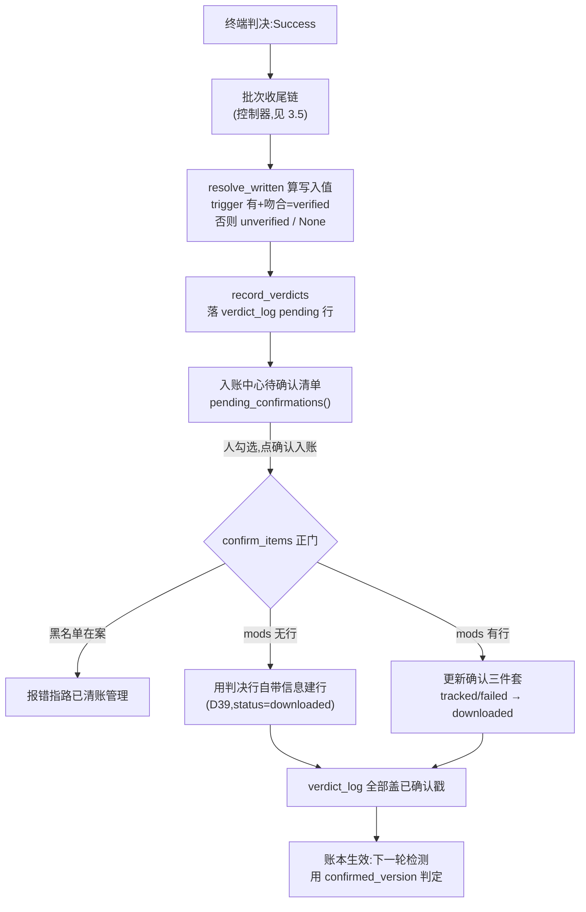

---

## 3.3 网址解析与命令生成

### 功能说明

- `core/urlParser.py` —— 从工坊网址 / 纯数字 / steamcmd 下载命令行三种形式提取 mod 编号;工坊网址模板全项目唯一定义点。
- `core/commandBuilder.py` —— 把 mod 清单拼成 steamcmd 命令文本;**只做拼字符串**,不碰数据库、不弹窗、不联网。
- `core/constants.py` —— 一级单源常量(状态值、netGate 入口名、导航页 ID);叶子模块,禁止 import 项目内任何东西。
- `core/formatters.py` —— 状态中文、相对时间、大小格式化的单源(各表格页共用)。

### 代码片段与逐段注释

**片段① 三形式解析 —— `core/urlParser.py:44-63`**

```python
_ID_PARAM = re.compile(r"[?&]id=(\d+)")
# 下载命令片段:workshop_download_item <游戏AppID> <mod编号>
# 两个编号都要:mod 编号入清单,AppID 带回去和当前档案比对(防错档)
_CMD_ITEM = re.compile(
    r"(?:\+)?workshop_download_item\s+(\d+)\s+(\d+)", re.IGNORECASE)


def extract_mod_id(text: str) -> int | None:
    """单个片段 → mod 编号;无法识别返回 None。"""
    text = text.strip()
    if not text:
        return None
    if text.isascii() and text.isdigit():
        return int(text)

    if "steamcommunity.com" in text:
        m = _ID_PARAM.search(text)
        if m:
            return int(m.group(1))
    return None
```

**为什么这么写**:

- 命令行正则**必须捕获两个编号**:mod 编号入清单,游戏 AppID 单独带回——拿它和当前档案比对,能拦住"把 A 游戏的命令粘进 B 档案"的错档事故(`urlParser.py:10-14`:"命令行必须在按空白切分之前整段识别——如果切成散词,命令里的游戏 AppID 会被误当成 mod 编号混进清单")。
- 纯数字判断用 `isascii() and isdigit()` 而不是 `int()` 包 try:全角数字 `123` 也能被 `int()` 接受,但它不是工坊编号,放进去只会制造错账。
- 无法识别的片段**原样回报、不猜不纠正**(`urlParser.py:17-18`):"无法识别的片段(包括命令行里的登录名、退出等修饰词)原样回报给调用方展示——不猜、不纠正、不静默丢弃。"

**片段② 命令行的整段识别与挖除 —— `core/urlParser.py:84-101`**

```python
        # 第一步:整行先认一遍下载命令。命中就收下命令里的 mod 编号,
        # 并把命令片段从行里挖掉,剩下的部分照常按空白切分解析。
        # 挖除是关键:不挖的话 AppID 会被下一步当成纯数字编号收进清单。
        if _CMD_ITEM.search(raw):
            for app_text, mid_text in _CMD_ITEM.findall(raw):
                mid = int(mid_text)
                if mid not in seen:
                    seen.add(mid)
                    ids.append(mid)
                app = int(app_text)
                if app not in cmd_apps:
                    cmd_apps.append(app)
            raw = _CMD_ITEM.sub(" ", raw)
        # 第二步:常规解析(纯数字 / 工坊网址),与升级前行为完全一致
        for token in raw.split():
            mid = extract_mod_id(token)
            if mid is None:
                invalid.append(token)
            elif mid not in seen:
                seen.add(mid)
                ids.append(mid)
```

**为什么这么写**:

- "挖除再解析"是个不起眼但极关键的次序设计:先整体识别命令并 `sub(" ", raw)` 把命令片段挖掉,剩余部分才逐词解析。不挖的话,命令里的 AppID 是纯数字,第二步会把它当 mod 编号收进清单——错档事故的另一入口。
- 兼容两种导出格式(每行一个 / 整段空格分隔)是旧脚本时代遗留的真实需求:用户手里最多的素材就是老版本生成的命令文件。

**片段③ 分组尺子 —— `core/commandBuilder.py:38-76`(节选)**

```python
def group_mods(mods):
    """把 mod 列表分成三组,返回字典,每组内部按 mod_id 从小到大排。

    分组尺子(和更新检测同一把:API time_updated > confirmed_version,
    仅 downloaded):
    - 本地没有确认版本(confirmed_version 空 = 未下载,或已下载但
      版本未知)→ "not_downloaded"(键保持英文,命令生成页组标题
      显示"待下载",与 mod 库页状态词同源)。版本未知的已下载条目
      也落这组:没有版本锚就谈不上"落后",勾选重下无害,且正是
      补版本的正当手段之一(右键设定本地版本也可以)
    - 远端比确认版本新(time_updated > confirmed_version)
      → "needs_update" 需要更新
    - 有确认版本但从没查过远端(time_updated <= 0)→ 也归
      "需要更新"(宁可让用户多下载一遍,也不能漏掉可能的新版本)
    - 其余(查过且远端不比确认版本新)→ "up_to_date" 已最新
    - status 是 deleted / failed 的 mod 一律不出现
    """
    groups = {
        "needs_update": [],
        "not_downloaded": [],
        "up_to_date": [],
    }
    for m in mods:
        if m.status in ("deleted", "failed"):
            continue
        local = int(m.confirmed_version or 0)   # 确认版本(空 = 无版本锚)
        remote = int(m.time_updated or 0)
        if local <= 0:
            groups["not_downloaded"].append(m)
        elif remote <= 0:
            # 有版本锚、远端还没查过:保守处理,当成需要更新
            groups["needs_update"].append(m)
        elif remote > local:
            groups["needs_update"].append(m)
        else:
            groups["up_to_date"].append(m)
    for key in groups:
        groups[key].sort(key=lambda m: int(m.mod_id))
    return groups
```

**为什么这么写**:

- docstring 第一行就点明**和更新检测用同一把尺子**——判定公式全项目只有一份口径。命令生成页把"需要更新/待下载/已最新"三组分开展示,用户勾选时心里有数;分组结果与检测页的分桶永远不会打架,因为公式同源。
- "从没查过远端也归需要更新"是**保守方向**的显式决策:宁可让用户多下载一遍(steamcmd 秒下缓存命中的成本极低),不能漏掉可能的新版本。
- deleted/failed 一律不出现:删除态的 mod 出现在"待下载"清单里,等于变相绕过删除决定。

**片段④ 命令文本的收尾约定 —— `core/commandBuilder.py:84-88` 与有意不做清单 `core/commandBuilder.py:20-28`**

```python
def build_copy_text(app_id, mod_ids):
    """把命令行拼成一段文本,直接进剪贴板。
    结尾留一个换行:粘贴进 steamcmd 后直接回车就行,不用再补。
    """
    return "\n".join(build_plain_commands(app_id, mod_ids)) + "\n"
```

```text
有意不做的事(写下来防止以后被"好心"加回来):
- 不生成登录命令:登录由用户在 steamcmd 里自己完成,
  软件只提供"复制登录命令"的便捷按钮(内容来自设置页,原样传递
  不解析);
- 不生成 force_install_dir:下载位置由 steamcmd 自己的默认规则决定;
- 不生成 .bat / +runscript / +quit:手动粘贴已覆盖全部场景;
- 日常更新命令不加 validate(增量由下载本身保证,加了更慢且可能
  冲掉 mod 内自定义文件;validate 只在核验页"怀疑文件损坏、想彻底
  校验"的修复场景使用)。
```

**为什么这么写**:

- "有意不做的事"写进注释是防御性文档化:这些边界都是踩坑或权衡后定的(比如 validate 会冲掉 mod 内自定义文件),不写下来,未来的"好心优化"一定会把它们加回来。
- 多行文本粘贴会被 steamcmd 逐行依次执行,前一条下完才开始下一条——所以数量不限,而 Windows "单条命令 8191 字符"的上限永远碰不到(每行只有一条命令,`commandBuilder.py:10-13`)。

### 执行逻辑流程图

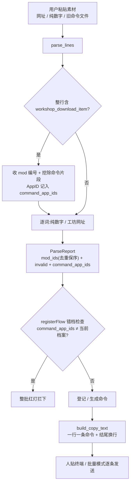

---

## 3.4 Steam 官方接口客户端

### 功能说明

- `core/steamApiClient.py` —— 匿名接口(GetPublishedFileDetails / GetCollectionDetails / appdetails)与 keyed 接口(IPublishedFileService/GetDetails,带 key 才返回依赖清单);重试、退避、协作式取消全部单源在一个私有方法里。
- `core/netGate.py` —— 跨页面联网互斥闸 + 退场看护:同一时刻只允许一个入口在查;退出时等不到的网络线程 park 保活。
- `gui/remoteQueryWorker.py` —— 三个检测页共用的批查询线程(100/批、批间礼貌间隔、批边界停止协议)。

### 代码片段与逐段注释

**片段① 重试单源 —— `core/steamApiClient.py:364-425`**

```python
    def _request_json(self, url: str, send: Callable[[], requests.Response]) -> dict:
        """发一次请求 → 解析 JSON,重试三档(POST/GET 共用这一份逻辑):

        - 429/503、网络异常、空响应体:值得重试,指数退避(等待翻倍)
        - 其他非 200(如 404):立刻报错,重试没有意义
        - 重试用完仍失败:抛 SteamApiError,把最后一次的失败原因带出去
        - 取消置位:任何检查点/退避等待里立即抛 SteamApiCancelled
          ——重试与退避都不再发生

        每次失败都打一条 warning:重试期动辄一两分钟,不出声会被
        当成卡死。

        send 是"怎么发这个请求"的无参函数(POST 还是 GET 由调用方决定),
        本方法只管"发了之后怎么算失败、失败了怎么办"——重试策略只有
        这一份,改判定/改退避只动这里,绝不出现两处走样。
        """
        last_exc: Exception | None = None
        for attempt in range(self._max_retries + 1):  # 首次 + N 次重试
            self._check_cancel()
            try:
                resp = send()
            except requests.RequestException as exc:
                last_exc = exc
                if attempt < self._max_retries:
                    logger.warning(
                        "Steam 请求失败(第 {}/{} 次):{};{} 秒后自动重试"
                        "(不是卡死,是在重试)",
                        attempt + 1, self._max_retries + 1, exc,
                        self._interval_ms / 1000 * (2 ** attempt))
                # 最后一次失败不打日志:紧接着的抛错由调用方上报
            else:
                if resp.status_code in _RETRY_STATUSES:
                    last_exc = SteamApiError(
                        f"HTTP {resp.status_code}(疑似限流)")
                    if attempt < self._max_retries:
                        logger.warning(
                            "Steam 接口限流(HTTP {},第 {}/{} 次);"
                            "{} 秒后自动重试",
                            resp.status_code, attempt + 1,
                                              self._max_retries + 1,
                                              self._interval_ms / 1000 * (2 ** attempt))
                elif resp.status_code != 200:
                    raise SteamApiError(
                        f"HTTP {resp.status_code},接口:{url}")
                else:
                    try:
                        return resp.json()
                    except ValueError as exc:
                        last_exc = exc
                        if attempt < self._max_retries:
                            logger.warning(
                                "Steam 响应不是合法 JSON(第 {}/{} 次);"
                                "{} 秒后自动重试",
                                attempt + 1, self._max_retries + 1,
                                self._interval_ms / 1000 * (2 ** attempt))
            if attempt < self._max_retries:
                # 指数退避:等待可被取消立即打断
                self._sleep_cancellable(
                    self._interval_ms / 1000 * (2 ** attempt))
                self._check_cancel()
        raise SteamApiError(
            f"请求多次失败(共 {self._max_retries + 1} 次):{last_exc}")
```

**为什么这么写**:

- `send` 用**无参函数注入**(POST/GET 差异留在调用方闭包里),本方法只管"失败判定 + 退避 + 取消"——这是"重试策略只有这一份"的实现手段。改判定、改退避只动这里;两份重试代码迟早走样,这是项目注释里反复出现的"单源纪律"的一次典型落地。
- **403 不重试**是 keyed 接口的重要口径(`steamApiClient.py:337-338`):403 = key 无效/被重置,重试无意义;只有 429/503(限流)与网络异常值得重试。
- 每次失败都 warning 而不是静默重试——重试期动辄一两分钟,"不出声会被当成卡死"(注释原话);这就是 FAQ 里"检测总失败?看运行日志里的'第 N/M 次…在重试'"的出处。
- 文件顶部 `truststore.inject_into_ssl()`(`steamApiClient.py:55-57`)解决的是另一类故障:公司/自签证书环境下 requests 默认证书库会报 `CERTIFICATE_VERIFY_FAILED`,注入系统证书库后与浏览器同源;失败静默退回 certifi,不装 truststore 也能跑。

**片段② keyed 接口:children 三态 —— `core/steamApiClient.py:331-361`**

```python
    def query_details_keyed(self, mod_ids: Iterable[int], key: str,
                            *, batch: int = 100) -> list[KeyedItem]:
        """带 key 的 GetDetails:唯一返回 children(必需物品清单)
        的官方接口。分批(官方上限 100)+ 批间礼貌间隔 + 取消检查
        点;重试/退避复用 _request_json 一份逻辑。请求形状与密钥页
        探针(已实测打通的那次)完全一致:GET + includechildren。
        403 = key 无效/被重置——不重试(非 429/503 的既定行为),
        消息由调用方转译成人话。只发请求和解析,不碰库不碰界面。"""
        ids = list(dict.fromkeys(int(i) for i in mod_ids))
        items: list[KeyedItem] = []
        for start in range(0, len(ids), batch):
            self._check_cancel()
            chunk = ids[start:start + batch]
            params: dict[str, str] = {
                "key": key,
                "includechildren": "true",
                "includemetadata": "true",
            }
            for i, mid in enumerate(chunk):
                params[f"publishedfileids[{i}]"] = str(mid)
            data = self._get_json(KEYED_DETAILS_URL, params)
```

**为什么这么写**:

- `includechildren=true` **必须显式带**:不带该参数,响应条目里根本没有 children 键——"共 0 项"假象的根因(项目实测记录)。由此引出 children 三态语义:`list = 清单(可空 = 真无依赖);键缺席 = 参数未生效/接口行为变了——两种状态绝不混同`。
- 数组参数 `publishedfileids[0]=...` 是官方接口形状;`_BATCH = 100` 是官方单批上限,超限必须自己分批。

**片段③ 联网互斥闸与退场看护 —— `core/netGate.py:26-43` 与 `core/netGate.py:45-62`**

```python
def try_acquire(owner: str) -> str | None:
    """申请联网查询名额:拿到返回 None;被占返回占用方名字。"""
    global _owner
    with _lock:
        if _owner is None:
            _owner = owner
            return None
        return _owner


def release(owner: str) -> None:
    """归还名额(在后台线程的 finished 收尾里调——无论成功/失败/
    停止 finished 都必发,放这里一次就够,漏不掉)。"""
    global _owner
    with _lock:
        if _owner == owner:
            _owner = None
```

```python
def park(worker) -> None:
    """shutdown 等不到的线程挪进来保活,并确保退场守卫已装。
    模块级列表 = 进程死亡前绝无销毁,"销毁仍在运行的线程"从根上
    不可能发生。"""
    global _armed
    if worker is not None and worker.isRunning():
        _parked.append(worker)
        if not _armed:
            from PySide6.QtWidgets import QApplication

            def _on_quit() -> None:
                if any(w.isRunning() for w in _parked):
                    # 走到这里 = closeEvent 已全部收尾,只剩卡在
                    # 网络里的查询线程——随进程退场最干净
                    os._exit(0)

            QApplication.instance().aboutToQuit.connect(_on_quit)
            _armed = True
```

**为什么这么写**:

- 互斥闸的动机是两起实测事故(`netGate.py:3-6`):"更新检测与联网深度检测是两条互不知情的联网入口,可以同时跑——网络不畅时双双卡进超时重试。互斥闸让同一时刻只有一个入口在查,后到的当场被拒并**告知谁在占**"。被拒时返回占用方名字,用户能判断要等多久,而不是面对一个莫名的"失败"。
- `release` 放在后台线程的 `finished` 收尾而不是各个结局分支:QThread 的 finished 无论成功/失败/停止都必发,一次 connect 覆盖全部路径,漏不掉——这是"收尾逻辑挑必然发生的信号挂"的接线纪律。
- `park` 解决的是 Qt 最险的坑之一:**销毁仍在运行的 QThread 会直接终止进程**(0xC0000409 闪退)。等 1.5 秒等不到就把线程引用挪进模块级列表保活到进程死亡;`aboutToQuit` 时若还有存活线程,`os._exit(0)` 干净带走——线程只发网络请求不写库,强杀零数据损失。

**片段④ 批查询线程的停止协议 —— `gui/remoteQueryWorker.py:82-120`**

```python
    def run(self) -> None:
        query = self._make_query(self._cancel)
        done = 0
        entries: list[dict] = []
        try:
            for start in range(0, len(self._ids), _BATCH):
                if self._stop_requested:
                    self.stopped.emit()
                    return
                chunk = self._ids[start:start + _BATCH]
                items = query(chunk)
                entries.extend(self._to_entry(i) for i in items)
                done += len(chunk)
                self.batch_done.emit(done)
                if start + _BATCH < len(self._ids):
                    # 批间礼貌间隔;等待期间无法响应停止(取消事件
                    # 已让客户端侧的等待可中断,这里是批与批之间的
                    # 纯 sleep),最多多等一个间隔——与 V1 同口径
                    time.sleep(self._interval_ms / 1000)

        except SteamApiCancelled:
            # 取消事件在请求/等待中途触发:与批边界停止同一收场
            self.stopped.emit()
            return
        except SteamApiError as exc:
            # 停止竞态(2026-10 修复):stop() 置位后,在途请求若恰好
            # 快速失败(如 RemoteDisconnected),抛的是网络错误而不是
            # 取消——但停止意图已表达,按"已停止"收场,不报失败
            # (实录:20:33:36 请求停止 → 20:33:54 弹"依赖拉取失败")
            if self._stop_requested:
                self.stopped.emit()
                return
            self.failed.emit(str(exc))
            return

        if self._stop_requested:
            self.stopped.emit()
            return
        self.succeeded.emit(entries)
```

**为什么这么写**:

- **停止 = 什么都没发生**:已查到的数据一律丢弃、走 stopped 信号——半途数据落库会让"停止"变成"停了一半的检测",账面出现"查了一半"的假象。
- except 分支里先查 `_stop_requested` 再报失败,是实测修复的停止竞态:stop() 置位后在途请求恰好快速失败时,抛出的是网络错误而非取消异常;不查停止位就会把"用户主动停止"误报成"检测失败"。
- 四信号分工(`batch_done / succeeded / failed / stopped`)让页面不用理解线程内部状态机,每种结局都有一个明确回执。

### 执行逻辑流程图

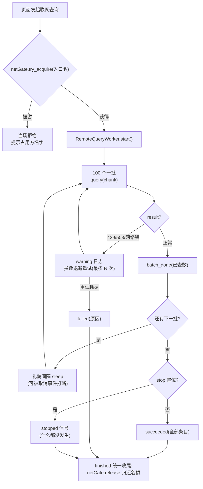

---

## 3.5 内置终端与下载判决

### 功能说明

这是 V2 判决制的"票据打印处",四件协作:

| 件 | 职责 |
|---|---|
| `gui/terminalDock.py` | ConPTY 伪终端:启动/停止 steamcmd、显示原文、发命令;信号 `verdict_emitted` 与 `idle_prompt_seen` 是批次的两条输入线 |
| `core/outputAnalyzer.py` | 逐行分析 steamcmd 输出 → 结构化结论(9 种判定),**唯一票据来源**;纯函数零写库 |
| `core/batchDownloadFlow.py` | 批次状态机:等提示符再发下一条;`resolve_written` 是判定分支全项目唯一实现 |
| `gui/batchDownloadController.py` | 收尾链:汇总 → 剔黑 → 批查 → 落 pending → 弹确认清单 |

### 代码片段与逐段注释

**片段① 为什么是 ConPTY 而不是管道 —— `gui/terminalDock.py:7-20`(文件头注释摘录)**

```python
"""
【为什么用伪控制台(ConPTY)而不是普通管道——踩坑记录】
第一版用 QProcess(管道)启动 steamcmd,结果启动横幅之后什么都
不显示:Loading Steam API...OK、Steam> 提示符、登录应答全部消失。
原因:进程输出接到管道后,C 运行时默认"满缓冲"——攒够约 4KB 才
真正吐一次数据。steamcmd 的启动横幅是初始化时主动刷出的所以能看到,
后面的应答一行几十字节永远凑不满 4KB,全堵在缓冲区里。黑色窗口
没这个问题,因为真控制台是"写一行显示一行"。
解决:改用 pywinpty(Spyder/Jupyter 终端的同款底层)创建 Windows
伪控制台(ConPTY)——给子进程一个"看起来是真控制台"的环境,
steamcmd 的行为与手动双击完全一致:逐行吐输出、自己回显命令、
自己打 Steam> 提示符。附带两个简化:
- 命令回显由控制台自己做,本面板不再手动补回显;
- ConPTY 输出统一是 UTF-8,pywinpty 直接返回 str,
  不再需要 UTF-8/GBK 两级解码。
"""
```

**为什么这么写**:

- 这段注释的价值在于把**故障机理**留给后人:管道满缓冲问题决定了"换回 QProcess 简化"的任何尝试都会复发。三个实操细节(读线程、剥 ANSI、240 列宽防折行)都写在文件头,其中 **240 列宽直接关系判决准确性**:太窄时 `Success. Downloaded item …` 长行被折成两行,逐行判定的正则就断了(`terminalDock.py:46-49`)。

**片段② 输出判决的边界与坑 —— `core/outputAnalyzer.py:34-46`(文件头摘录)与 `core/outputAnalyzer.py:141-163`**

```python
"""
1) steamcmd 会把结论续在"Downloading item …"同一行后面,比如
   "Downloading item 2978597407 ...ERROR! Timeout downloading item …"。
   所以"下载开始"必须整行匹配(行尾就是省略号才算开始),
   其余模式用"包含即命中",且"下载开始"永远排在最后检查——
   混合行先被前面的结论模式接住,轮不到"开始"。
2) 失败原因写在括号里(Failure / No subscription / Timeout…),
   属于 steamcmd 的原文,原样捕获不做翻译,展示层只负责展示。

判定的边界:
- 断线后的 "Retrying..." 行不单独判定——断线那一行已经把事说清,
  重试行只负责在原始输出里刷屏,分析器不必跟着嚷;
- 账实口径不变(决策 23):账实口径(v2 判决制):这里的"成功/失败/超时"是判决信号——收尾链据此落 verdict_log(pending),版本写入仍只走确认门(R17);本模块本身绝不写库、绝不改 mod 状态。
  本模块绝不写库、绝不据此改 mod 状态。
"""
```

```python
def classify_line(line: str) -> Verdict | None:
    """一行输出 → 结论;不在任何模式里返回 None(调用方忽略即可)。

    行尾的 \r(Windows 控制台)先剥掉再比对,避免"看起来一样
    实际差个回车"对不上模式。
    """
    text = line.rstrip("\r\n").strip()
    if not text:
        return None
    for pattern, build in _PATTERNS:
        m = pattern.search(text)
        if m:
            return build(m)
    return None


def is_idle_prompt(line: str) -> bool:
    """这行是不是"空闲提示符"(一行只有 Steam>,后面没内容)。

    是 → steamcmd 在等下一条命令,批量流程可以发下一条;
    否(包括命令回显行 Steam>workshop_…)→ 继续等。
    """
    return _IDLE_PROMPT.match(line.strip()) is not None
```

**为什么这么写**:

- **"开始"垫底**是这套模式表的核心排序约束:结论会续在"下载开始"同一行,若"开始"用包含匹配又排前面,混合行会被误判成"刚开始",真正结论(Timeout/Success)永远读不到。整行匹配(行尾省略号才算)+ 排序垫底,双保险。
- 分析器**绝不写库**:它是"把文本翻译成结论"的纯函数层。判决信号的消费(落 verdict_log)在收尾链——职责分层,pytest 喂文本就能测,测试样本全是真实输出原文("测试即格式快照,steamcmd 改版一跑测试就知道哪里断了")。
- `is_idle_prompt` 用 `^Steam>$` 全行锚定:命令回显行 `Steam>workshop_download_item …` 同样以 Steam> 开头但带内容,全行匹配天然区分"空闲"与"回显"。

**片段③ 批次状态机的节奏钥匙 —— `core/batchDownloadFlow.py:34-39`(文件头摘录)与 `core/batchDownloadFlow.py:170-200`**

```python
"""
为什么"等空闲提示符才发下一条"(本模块最核心的一条设计):
真实样本里结论会续在"开始下载"同一行(Downloading item …ERROR!
Timeout …),而且大 mod 下载几个小时都正常——用时间判断"这条
完事了"必然误判。唯一可靠的信号是 steamcmd 打出单独一行 Steam>
(空闲提示符),等价于"人眼看到提示符再粘贴"。所以每条的节奏是:
发命令 → 等结论(记账)→ 等空闲提示符 → 发下一条。
"""
```

```python
    def start(self, login_cmd: str | None = None) -> bool:
        """开始批次。给了 login_cmd 就先登录,等登录成功再逐条下载。
        返回是否成功启动(已在跑 / 列表为空 / 第一条命令就发不出去 →
        False;最后这种情况批次会以出错收尾,batch_done 事件照发,
        GUI 靠事件显示失败原因,返回值只说明"没启动起来")。
        """
        if self._state != ST_IDLE or not self._pending:
            return False
        self._login_cmd = (login_cmd or "").strip() or None
        if self._login_cmd:
            # 登录决策 19:设置里的命令原样发送,不解析、不拼装。
            # R2:登录命令含密码,失败文案必须脱敏
            self._state = ST_LOGGING_IN
            if not self._try_send(
                    self._login_cmd,
                    fail_note="登录命令发送失败(steamcmd 没在运行?)"):
                return False
            self._emit("login_started", note="登录命令已按设置原样发送")
            return True
        return self._advance()

    def stop(self) -> None:
        """用户点停止:温和停止——不再发新命令,当前那条让它跑完。
        已在等空闲提示符 / 等登录 / 等手动登录 → 立即收尾;
        正在下载某条 → 置 STOPPING,那条的结论到了再收尾。
        """
        if self._state in (ST_WAITING_IDLE, ST_NEED_LOGIN, ST_LOGGING_IN):
            self._finish(stopped=True)
        elif self._state in (ST_RUNNING,):
            self._state = ST_STOPPING
            self._emit("stop_requested", mod_id=self._current)
```

**为什么这么写**:

- **不做超时判死**是显式的设计限制(文件头"已知限制"):"大 mod 下载几小时正常,强行判死会误杀;真卡死由用户手动【停止 steamcmd】兜底"——这是"软件不代替用户判断"哲学在下载编排上的落点。
- 温和停止不杀进程:强杀 steamcmd 会丢本机登录缓存,代价大于多等一条的时间;"当前条跑完再收尾"对用户无损。
- 登录命令整行 strip 原样传递、绝不解析(R2 红线:命令含密码,解析即泄漏风险)。

**片段④ 判定分支全项目唯一实现 —— `core/batchDownloadFlow.py:121-132`**

```python
def resolve_written(trigger: int | None,
                    query: int | None) -> tuple[int | None, str]:
    """D4 判定分支:→ (写入版本, 来源)。规则见上方总表。"""
    if trigger is None:
        # 无触发值:手动批次没有"点的哪个版本"的凭证,写 NULL =
        # 版本未知态。批查成功与否都不改变这一点(理由见上)。
        return None, "unverified"
    if query is not None and query == trigger:
        # 现场与触发值吻合:背书成立
        return trigger, "verified"
    # 有触发值但批查失败 / 现场不吻合:照写触发值(保守),来源如实
    return trigger, "unverified"
```

**为什么这么写**:

- 分支总表(`batchDownloadFlow.py:102-119`)论证了一个关键时序问题——**为什么批查值哪怕拿到了也绝不直接入账**:"批查发生在下载之后,若远端恰在'下载完成→批查'之间又更新,批查值会比盘上内容新——写它就是高估。触发值之所以可信,正因为它早于下载、只会 ≤ 盘上内容;批查值没有这个时序保证。"这四行代码是 R18"写入值永不高估"的全部实现,放 core 做纯函数,pytest 直测,控制器只准调用、不准另写第二份。

**片段⑤ 收尾链:从终端判决到待确认清单 —— `gui/batchDownloadController.py:554-613`(节选)**

```python
        # ③ 没有成功条目:没有可确认的东西,到此为止
        if not ok:
            self._log.info("本批没有成功条目:无待确认项")
            return
        # ④ 剔黑名单(D11 三拦之一):黑名单条目已下载的不拦(下载是
        # 盘面行为),但绝不落待确认——防手滑确认入账
        purged = self._repo.filter_purged([r.mod_id for r in ok])
        net_ok = [r for r in ok if r.mod_id not in purged]
        if purged:
            self._log.warn(f"{len(purged)} 条在已清账黑名单,"
                           "不列入待确认清单(编号:" +
                           "、".join(str(m) for m in sorted(purged)) + ")")
        if not net_ok:
            self._log.info("成功条目全部在黑名单:无待确认项")
            return
        # ⑤ 收尾批查(下载后的现场核对):成功条目逐条拿现场版本,
        # 供 resolve_written 判 verified / 降级 / 版本未知
        self._log.info(f"正在核对 {len(net_ok)} 条成功条目的远端版本…")
        self._query_worker = _QueryWorker([r.mod_id for r in net_ok])
        self._cleanup_worker_on_finish(self._query_worker, "_query_worker")
        self._query_worker.done.connect(
            lambda result, err: self._on_final_query(
                game, net_ok, result, err))
        self._query_worker.start()
```

```python
    def _on_final_query(self, game, net_ok: list, result: dict, error: str) -> None:
        if error:
            # 批查失败不拦入账(D4c):全部按查询失败走,触发值照写
            self._log.warn(f"远端版本核对失败({error}):成功条目将按"
                           "「未验证」入账,下轮更新检测会重新核对")
        rows = []
        mismatched: list[int] = []  # 下载期间远端又更新了的(trigger≠query)
        metas: dict[int, dict] = {}  # 批查成功的远端元数据(回填库用)
        for r in net_ok:
            q, title, size, creator = result.get(
                r.mod_id, (None, None, None, None))
            written, source = resolve_written(r.trigger, q)
            if r.trigger is not None and q is not None and q != r.trigger:
                mismatched.append(r.mod_id)
            if q is not None:
                metas[r.mod_id] = {"time_updated": q, "title": title,
                                   "creator": creator, "file_size": size}
            rows.append({
                "mod_id": r.mod_id,
                "kind": "success",
                "game_id": game.app_id,
                "version_trigger": r.trigger,
                "version_query": q,  # 现场值留档,对账有据
                "version_written": written,  # D4 分支结果(R18:≤ 触发值)
                "title": title,  # D39:落 pending 顺手存
                "file_size": size or r.size_bytes,  # 批查优先,退下载实测
                "source": source,
            })
        self._repo.record_verdicts(rows)
        # 本批已给出更优判决(success 待确认):早先扫描留下的同编号
        # 未确认 claim 提案就此作废(提案跟随更优事实)——只删未确认
        # claim 行,确认行与其他 kind 不动(repo 契约原样)
        self._repo.drop_stale_claims(game.app_id, [r["mod_id"] for r in rows])
```

**为什么这么写**:

- 收尾链的次序本身就是设计:剔黑名单在落 pending **之前**——黑名单条目可以下载(盘面行为拦不住),但绝不给它进确认清单的机会;批查在落 pending **之前**——`resolve_written` 需要现场值才能判 verified/unverified。
- **批查失败不拦入账**(D4c):核对失败时全部按"未验证"入账——下载成功是终端判决过的事实,不能因为网络抖动白下一轮;来源如实降级,库页灰显,下轮检测自然会重新核对。诚实降级优于阻塞。
- 下载期间远端又更新的条目(mismatched)**不批次内自动重下**(`batchDownloadController.py:629-632` 注释:"作者连更时永不收敛")——按触发值诚实收录(未验证),下轮检测必然重报,跨批收敛。批次内重试循环在作者连更场景下是无底洞。

**片段⑥ 终端命令的唯一入口 —— `gui/terminalDock.py:311-329` 与退出收尾 `gui/terminalDock.py:337-357`**

```python
    def send_command(self, text: str) -> bool:
        """向 steamcmd 发一行命令。返回是否已发出。

        用户输入框和将来的批量编排都从这一条路走。ConPTY 模式下
        命令回显和 Steam> 提示符由控制台自己完成(和黑色窗口一样),
        本方法不再手动补回显。
        """
        if not self._is_running():
            self._log.warn("steamcmd 未在运行:命令没有发出")
            return False
        text = text.strip()
        if not text:
            return False
        try:
            self._pty.write(text + "\r\n")
        except (EOFError, OSError):
            self._log.error("steamcmd 已退出:命令没有发出")
            return False
        return True
```

```python
    def shutdown(self) -> None:
        """程序退出前的收尾(MainWindow.closeEvent 统一调用)。

        退出路径上没有第二次机会,这里同步等待:先给 quit 3 秒,
        还不退就强杀——收尾阶段允许短暂阻塞,换"退出时保住登录缓存"。
        """
        if self._is_running():
            try:
                self._pty.write("quit\r\n")
            except (EOFError, OSError):
                pass
            deadline = time.time() + 3.0
            while self._is_running() and time.time() < deadline:
                time.sleep(0.1)
            if self._is_running():
                try:
                    self._pty.terminate(force=True)
                except Exception:
                    pass
        if self._reader is not None:
            self._reader.wait(3000)
```

**为什么这么写**:

- "入口只有一条"是防腐设计:手动输入框、登录下拉、批量编排全部经 `send_command`——才有唯一位置做"steamcmd 在不在跑"的统一检查,不会有绕过检查的后门。
- 停止逻辑"先 quit 后强杀"(`terminalDock.py:55-57`):"先发 quit 命令优雅退出(保住本机的登录缓存,下次启动不用重新验证);5 秒还没退才强杀——强杀丢登录态,是不得已才用的手段。"

### 执行逻辑流程图

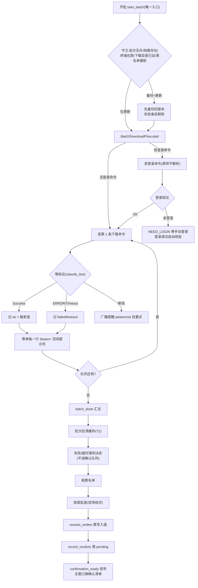

---

## 3.6 入账中心(登记/确认/认领/盘点)

### 功能说明

入账中心是 D32 定义的"四区终态"页面(`gui/accountCenterPage.py`):**待确认清单 / 待认领区 / 判决史 / 登记**,加上跨页入口。本节讲支撑它的三个引擎与一个解析器:

- `core/registerFlow.py` —— 登记区引擎:解析结果对账分类五桶、整批事务落库;
- `core/inventoryFlow.py` —— 只读盘点引擎:找候选、清失效、回填大小;
- `core/acfParser.py` —— 独立 ACF 解析件:盘面版本的合法读法(R19);
- `core/localScanner.py` —— 客户端 acf 已安装清单解析(首次使用向导第④步用)。

### 代码片段与逐段注释

**片段① 登记五桶分类 —— `core/registerFlow.py:55-89`**

```python
def classify_register(parsed: ParseReport,
                      existing: Mapping[int, Any],
                      purged: Iterable[int], *,
                      app_id: int) -> RegisterPlan:
    """解析结果与账本对表分类。纯函数、只读、零 IO。

    parsed:urlParser.parse_lines 的产出;
    existing:{mod_id: 任意有 .status 的对象},调用方用
        repo.list_mods(app_id) 现取成字典(纳入流程同口径);
    purged:黑名单命中集合(repo.filter_purged 的返回值)。
    """
    plan = RegisterPlan(app_id=app_id)
    plan.invalid = list(parsed.invalid)

    # 错档红灯:命令行里出现非当前档案的 AppID → 整批拦下(理由见
    # 文件头);无效行照常回报——那是格式反馈,与归属无关
    wrong = sorted({a for a in parsed.command_app_ids if a != app_id})
    if wrong:
        plan.wrong_game_apps = wrong
        plan.mismatch_ids = list(parsed.mod_ids)
        return plan

    purged_set = set(purged)
    for mid in parsed.mod_ids:            # 保持解析顺序(解析器已去重)
        mod = existing.get(mid)
        if mod is not None:
            plan.already_in_ledger.append((mid, mod.status))
        elif mid in purged_set:
            # 黑名单:登记照办(意图自由),确认/认领的正门会拦——
            # 拦截语义在确认门,这里只预警
            plan.to_register.append(mid)
            plan.blacklisted.append(mid)
        else:
            plan.to_register.append(mid)
    return plan
```

**为什么这么写**:

- **错档整批拦**而不是只拦命令里那几条,理由写在文件头(`registerFlow.py:19-23`):"urlParser 把编号与命令行 AppID 分开汇报、不逐条挂钩——混合粘贴时无法断言哪个编号来自哪条命令。归属存疑时宁可全拦,让用户分开粘贴;误登记的代价(命令生成错 AppID、下载 No match)比多贴一次高。"
- 黑名单"登记照办 + 预警"是**拦截语义的精确分界**:登记是"想下载"的意图存档,意图自由;真正的账面写入发生在确认门——黑名单的拦截语义住在那里(`sqliteRepository.py:1010-1013`),登记区只负责亮黄牌。

**片段② 登记落库:整批一个事务 —— `core/registerFlow.py:111-147`(节选)**

```python
def apply_register(repo, plan: RegisterPlan,
                   metadata: Mapping[int, RegisterMeta]) -> RegisterReport:
    """把计划落库:整批一个事务,要么全成要么全败。

    入库 = tracked("待下载");url 现拼不联网(登记不强制联网,
    元数据有则带、无则 NULL 等检测兜底)。time_updated 是登记时刻
    的远端观测值——"检测只写远端侧"的合法写入,不碰确认基准
    (确认基准只能走确认门,R17)。

    repo 只要求一个成员:transaction() 上下文 + add_mod(mod)——
    与纳入流程的 apply 同款最小接口,pytest 用假 repo 直测,
    不碰真库(真库行为由账本层自己的测试把关)。
    """
    report = RegisterReport()
    now = int(time.time())
    with repo.transaction():
        for mid in plan.to_register:
            meta = metadata.get(mid)
            has_meta = bool(meta and (meta.title or meta.time_updated
                                      or meta.file_size))
            repo.add_mod(Mod(
                mod_id=mid,
                game_id=plan.app_id,
                status="tracked",
                url=workshop_url(mid),
                title=meta.title if meta else None,
                creator=meta.creator if meta else None,
                file_size=meta.file_size if meta else None,
                time_updated=meta.time_updated if meta else None,
                first_tracked_at=now,
            ))
```

**为什么这么写**:

- `workshop_url(mid)` 现拼而不是留空:`urlParser.py:31-41` 的注释解释了兜底逻辑——"没登记 / 空白 → 按编号现拼(编号→网址是确定函数,认领或手动入账的条目没有存过网址也能打开页面)"。编号到网址是纯函数,存网址只是缓存,丢了无所谓。
- 登记时落的 `time_updated` 是**远端侧观测**(R17 允许的检测三路写库之一),确认三件套一个不碰——登记是"意图",不是"版本事实"。
- `with/without_metadata` 分开计数(`registerFlow.py:104-108`):"登记当轮'有没有标题'是用户可感知的质量差(建行当轮就有元数据,失败留 NULL 标注)"——失败留 NULL 并在下轮检测补全,而不是悄悄空着。

**片段③ 只读盘点引擎 —— `core/inventoryFlow.py:57-141`(核心节选)**

```python
def scan_game(repo, game, *, steamcmd_path: str | None = None) -> ScanReport:
    """盘点一个档案。目录不存在等环境问题记进报告返回,不抛——
    抛只抛真异常(权限等 OSError 由调用方兜)。"""
    base = _pick_mod_dir(game)
    if base is None:
        return ScanReport(acf_note="档案没设 mod 目录/下载目录,无从盘点")
    if not base.is_dir():
        # 不清提案:目录看不见 ≠ 盘面没了(移动盘没挂载、网络盘掉线
        # 都长这样)——提案跟随"看清楚的盘面",看不清就不动
        return ScanReport(mod_dir=str(base),
                          acf_note="目录不存在(先到档案设置里确认路径)")

    report = ScanReport(mod_dir=str(base))

    # ---- 盘面事实:整数命名的子目录 = mod ----
    folders: dict[int, Path] = {}
    for child in sorted(base.iterdir()):
        if child.is_dir() and _INT_DIR.match(child.name):
            folders[int(child.name)] = child
    report.folders_found = len(folders)
    if not folders:
        # 目录在、只是空:盘面确定没有这些 mod 了——未确认候选全部
        # 作废(提案跟随盘面;"删光文件夹再扫自动清"的兑现点)。
        # 已确认行与其他 kind 本就不在队列,天然不受影响
        pending = {v.mod_id
                   for v in repo.pending_confirmations(game.app_id)
                   if v.kind == "claim"}
        if pending:
            report.stale_removed = sorted(pending)
            repo.drop_stale_claims(game.app_id, pending)
        report.acf_note = "目录里没有整数命名的 mod 文件夹"
        return report

    versions = _read_versions(game.app_id, base, steamcmd_path, report)

    # ---- 现状一次拿齐(读侧)----
    pending_rows = repo.pending_confirmations(game.app_id)
    pending_claims = {v.mod_id for v in pending_rows if v.kind == "claim"}
    # 去重口径 = 任何未确认提案(claim 候选 / 批次 success 待确认):
    # 同一编号只允许一份待办——成功条目已在确认清单排队,扫描不再
    # 为它们落第二份 claim 候选(stale 清理仍只认 claim 行)
    pending_any = {v.mod_id for v in pending_rows}
    purged = repo.filter_purged(folders.keys())

    sizes: dict[int, int] = {}
    new_rows: list[dict] = []
    for mid, folder in folders.items():
        sizes[mid] = _dir_size(folder)
        mod = repo.get_mod(mid)
        if mod is not None and mod.confirmed_version is not None:
            report.skipped_accounted += 1        # 已彻底入账
            continue
        if mod is not None and mod.status == "deleted":
            report.skipped_other += 1            # 删除态:走恢复,不暗翻
            continue

        if mid in purged:
            report.skipped_other += 1  # 黑名单(D11 同款)
            report.skipped_purged += 1
            continue

        if mid in pending_any:
            report.candidates_dup += 1           # 幂等:提案已在队列
            continue
        ver = versions.get(mid)
        new_rows.append({
            "mod_id": mid, "kind": "claim", "game_id": game.app_id,
            "version_written": ver, "source": "claim",
            "title": None, "file_size": sizes[mid],
        })
        if ver is not None:
            report.versions_from_acf += 1
    if new_rows:
        repo.record_verdicts(new_rows)
        report.candidates_new = [r["mod_id"] for r in new_rows]

    # ---- 失效候选:提案跟随盘面 ----
    stale = sorted(pending_claims - folders.keys())
    if stale:
        report.stale_removed = stale
        repo.drop_stale_claims(game.app_id, stale)

    # ---- 大小回填(展示列;账上没有的编号 repo 自会忽略)----
    report.sizes_backfilled = repo.backfill_local_sizes(sizes)
    return report
```

**为什么这么写**:

- **"目录不存在"与"目录是空的"区别对待**是盘面哲学的精细处:目录看不见(移动盘没挂载、网络盘掉线)≠ 盘面没了,看不清就不动提案;目录在但空,才是盘面确定的表达——此时清掉全部未认领提案("删光文件夹再扫自动清"的兑现点)。误判方向若反了,用户的待认领清单会被一次掉线清空。
- 写入只走两扇既有正门:`record_verdicts`(落 claim 候选)与 `backfill_local_sizes`(展示列回填),文件头明确"本引擎不发明任何写库路径(R17)"。候选走 pending 队列而不是直接入账——盘点是机器,入账是人。
- 去重口径取"任何未确认提案"(`pending_any`):成功条目已在确认清单排队,扫描不再为它们落第二份 claim 候选——同一编号只允许一份待办,确认清单不被扫描灌水。
- 没有 acf 也继续扫(文件头第 24-25 行):"手动拷进来的 mod 没有 acf 记录,恰恰是最需要认领的一批——照落候选,版本留 NULL。"

**片段④ acf 盘面版本的合法读法 —— `core/acfParser.py:85-106`**

```python
def workshop_versions(tree: dict) -> dict[int, int]:
    """提取 {mod_id: timeupdated}。路径:AppWorkshop → apps →
    <appid> → WorkshopItemsMetadata → <mod_id> → timeupdated。
    结构对不上(键缺失/形状变化)按"没有元数据"处理返回空表——
    盘点照做,候选版本留 NULL(认成版本未知,检测补全)。"""
    result: dict[int, int] = {}
    apps = tree.get("AppWorkshop", {}).get("apps", {})
    if not isinstance(apps, dict):
        return result
    for app in apps.values():
        if not isinstance(app, dict):
            continue
        meta = app.get("WorkshopItemsMetadata", {})
        if not isinstance(meta, dict):
            continue
        for mid, node in meta.items():
            if isinstance(node, dict) and "timeupdated" in node:
                try:
                    result[int(mid)] = int(node["timeupdated"])
                except (TypeError, ValueError):
                    continue
    return result
```

**为什么这么写**:

- 只认 `WorkshopItemsMetadata.timeupdated`、绝不碰 `WorkshopItemsInstalled` 的时间——文件头(`acfParser.py:11-12`)写明:"WorkshopItemsInstalled 的安装时间不是版本,不混用。"这是 R19 在读侧的体现:acf 只提供"盘面线索",认领值还要过确认门才算账。
- **为什么独立成件**(`acfParser.py:9-10`):"格式解析自成一体,pytest 直接喂文本就测,不碰磁盘不碰账本(V1 把解析埋在 localScanner 肚子里没法单测,教训)。"
- 结构对不上返回空表而不是抛错:acf 是 steamcmd 的内部文件,格式随它改;盘点是"锦上添花的线索源",解析不动就当没有元数据,候选按版本未知落,检测补全。

**片段⑤ 跨页「送登记」直连 —— `gui/accountCenterPage.py:536-560`**

```python
    def receive_ids(self, mod_ids: list) -> bool:
        """跨页入口(依赖检测页/详情面板「送登记」):编号清单转行
        文本填进④登记粘贴框 → 自动解析预览(与页内【解析预览】同一
        动作,不写库)→ 展开④区。登记本身仍要人点【登记新编号】
        ——预览只摆事实(新登记/已在册/黑名单警示五类分色),写库
        的决定权留给人。返回是否受理(无档案 = False,主窗口不跳页)。"""
        ids = list(dict.fromkeys(
            int(i) for i in mod_ids
            if str(i).strip().lstrip("-").isdigit()))
        if not ids:
            return False
        if self._game is None:
            if self._log is not None:
                self._log.warn("送登记未受理:先在左上角选择游戏档案"
                               "(登记的编号归属当前档案)")
            return False
        self._paste_box.setPlainText(
            "\n".join(str(i) for i in ids) + "\n")
        self._sec_register.set_expanded(True)
        self._on_parse()
        if self._log is not None:
            self._log.info(f"已把 {len(ids)} 个编号带入【入账中心 · "
                           "登记】并解析预览——核对后点【登记新编号】"
                           "入账")
        return True
```

**为什么这么写**:

- "带入 + 自动预览,但**不写库**"是 D1 判决制精神在登记区的延续:预览只摆事实,写库的决定权留给人(点【登记新编号】才算数)。跨页自动化做到"减少手贴"为止,不越过人工背书的边界。
- 无档案时返回 False 而不是默默不动作:调用方(主窗口)据此决定跳不跳页,日志说明原因。

### 执行逻辑流程图

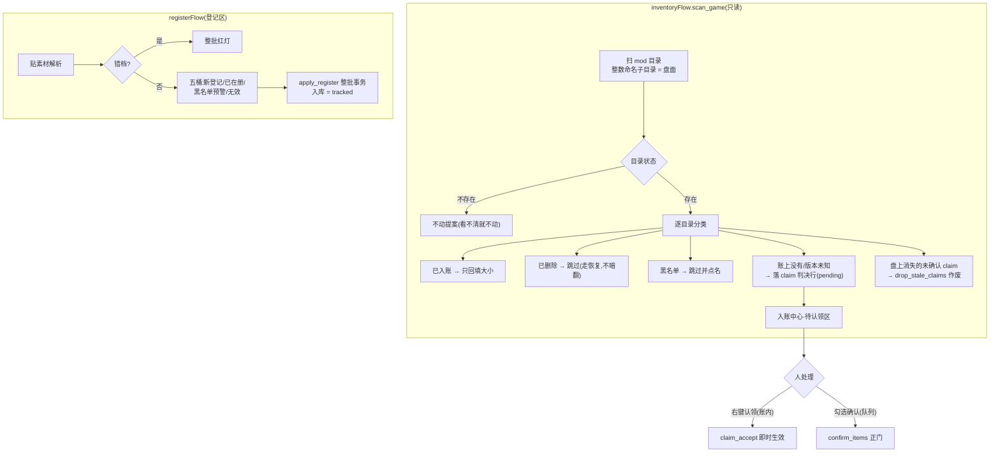

---

## 3.7 更新检测与异常分类

### 功能说明

- `gui/updateCheckPage.py` —— 检测页:联网互斥、进度中继(D42 第二表盘)、判定分桶、远端侧写库三路 + 失效归档。
- `workflows/exceptionFlow.py` —— 三个纯函数分类器:`classify_health`(远端健康)、`classify_dependencies`(依赖判定)、`classify_local_titles`(本地标题词表);页面只渲染,判定不散落。

### 代码片段与逐段注释

**片段① 检测入口的守卫链 —— `gui/updateCheckPage.py:332-379`(节选)**

```python
    def _start_check(self) -> str:
        """开一次检测。返回 "" = 已受理开跑;非空 = 拒绝原因(中文,
        给主窗口写日志用)。"""
        if self._game is None:
            return "没有选择档案"
        if self._worker is not None:
            return "已有检测在进行"
        mods = self._repo.list_mods(self._game.app_id,
                                    order_by="time_updated DESC")
        ids = [m.mod_id for m in mods if m.status != "deleted"]
        if not ids:
            self._summary.setText(
                "当前档案没有任何可检测的 mod(已删除的除外)。")
            self._summary.setStyleSheet("color: gray;")
            return "当前档案没有可检测的 mod"
        self._mods_at_start = mods
        # 记下"开始检测那一刻"的档案:本轮所有结果(含展开合集登记的
        # 条目)都写进它,即便检测过程中用户切到了别的档案
        self._check_game = self._game
        self._check_total = len(ids)     # 进度中继要用
        # 联网互斥闸:同一时刻只允许一个联网入口在查
        busy = netGate.try_acquire(constants.NET_GATE_UPDATE_CHECK)
        if busy is not None:
            self._summary.setText(
                f"另有联网任务在进行({busy}):等它结束后再检测。")
            self._summary.setStyleSheet("color: #f5a623;")
            return f"另有联网任务在进行({busy})"
```

**为什么这么写**:

- **返回 ""=受理 / 非空=拒绝原因**是 D42 的"拒绝不装作在跑"纪律:调用方(主窗口的日常更新模块页)能拿拒绝原因写日志,按钮不被锁死、不假启动。
- "记下开始检测那一刻的档案"防的是真实竞态:检测要几十秒,用户中途切档案,结果若跟随"当前档案"就会写串家;锁定 `_check_game` 让本轮所有写入都归发起时的档案。
- 已删除的 mod 不检测:`status != "deleted"` 过滤——删除是用户决定,检测不应该为已删除的条目重新点亮任何提醒。

**片段② 判定公式的检测侧分桶 —— `gui/updateCheckPage.py:434-446`**

```python
    @staticmethod
    def _kind_of(m: Mod) -> str:
        """D2 唯一公式的检测侧分桶(与 mod 库页"更新"列同源同尺):
        downloaded 且确认基准为空 = 版本未知;downloaded 且远端更新 >
        确认基准 = 需更新;其余(已最新 / 未下载 / 远端未知)不进表。"""
        if m.status != "downloaded":
            return "未下载"
        if m.confirmed_version is None:
            return "版本未知"
        if (m.time_updated is not None
                and m.time_updated > m.confirmed_version):
            return "需更新"
        return "已最新"
```

**为什么这么写**:

- 这十行是**三句核心架构第 1 句的完整代码形态**:`time_updated > confirmed_version`,且仅对 downloaded 生效;acf 不出现在公式里。docstring 点明"与 mod 库页'更新'列同源同尺"——检测页、库页、命令生成页三处分桶若各写一份,迟早漂移;项目用"同一把尺"的注释互相钉住。
- 版本未知单独成桶而不是混进"需更新":没有版本锚就谈不上"落后",把它标成"需更新"是撒谎;诚实显示"版本未知",补版本的正路是重下确认或右键设定。

**片段③ 依赖判定:children 三态的仲裁 —— `workflows/exceptionFlow.py:370-405`(节选)**

```python
    for e in entries:
        mid = e.get("mod_id")
        if mid is None:
            continue
        if e.get("result") != 1:
            skipped += 1
            continue
        children = e.get("children")
        if children is None:
            # children 键缺席的两层判读(2026-10-06 探针实测改判):
            # Steam 对"必需物品数为 0"的条目省略空清单不回键,但条目
            # 自带的 num_children 元数据照发——它不随 includechildren
            # 参数伸缩,等于 Steam 官方盖章"我有没有依赖"。
            #   =0 → 无依赖,按空清单走正常判定与入账(下次拉取有
            #        基线可比,不会永远停在"未判定");
            #   >0(说有却没给清单)或字段也缺席 → 真异常,保守记
            #        未判定,绝不冒充无依赖写库覆盖真实依赖边
            if _to_int(e.get("num_children")) == 0:
                children = []
            else:
                undetermined.append(mid)
                continue

        fetched += 1
        new_set = set(children)
        lack = sorted(i for i in new_set if i not in lib_ids and i != mid)
        if lack:
            missing[mid] = lack
        old = baseline.get(mid) or []
        if not first_fetch and set(old) != new_set:
            changed.append((mid, sorted(set(old)), sorted(new_set)))
        if not new_set:
            childless.append(mid)
```

**为什么这么写**:

- children 键缺席的**两层判读**是一段实测驱动的设计:Steam 对零依赖条目省略空清单不回键,但 `num_children` 元数据照发——用 `num_children == 0` 仲裁"真无依赖",其余缺席一律保守记"未判定"。绝不冒充无依赖写库覆盖真实依赖边,这是"两种状态绝不混同"原则(不静默口径)的落点。
- `first_fetch` 参数:依赖表还空着时只建基线,一切差异都不算"变化"——否则首次拉取会把全部依赖报成"依赖变化",警报被稀释。

**片段④ 远端健康判定:词表的宽容口径 —— `workflows/exceptionFlow.py:287-336`(节选)**

```python
def classify_health(entries: Iterable[dict], local_titles: dict[int, str],
                    *, keywords_raw: str | None = None) -> HealthFindings:
    """桶A 分类核心:对深检拿回的条目字典做健康判定。
    keywords_raw(2026-10 增补):设置页「远端弃坑提醒关键词」原文;
    None = 未传(回退模块默认 _ABANDONED_KEYWORDS——既有调用方与
    测试零变化);空串/纯空白 = 停用弃坑检测(标题不符/banned 照判)。
    判定口径:只对 result=1 的条目判——查询失败/失效的归桶⑤桶④,
    不重复报;标题比较双方剥版本记号、压空白、casefold 后比较——
    剥完还不一致才算"标题不符";弃坑关键词只扫远端标题(扫描述
    误报率不可控,刻意不扫);banned 字段缺席 → missing_banned_field
    置位,绝不静默当 0。"""
    # 词表解析(与 classify_local_titles 同款宽容口径):逗号/中文
    # 逗号/分号分隔、去空、casefold、去重;未传 = 模块默认,空 = 停用
    if keywords_raw is None:
        kws: tuple | list = _ABANDONED_KEYWORDS
    else:
        kws = sorted({k.strip().casefold()
                      for k in re.split(r"[,，;；]+",
                                        str(keywords_raw or "").strip())
                      if k.strip()})
```

**为什么这么写**:

- `keywords_raw=None / 空串` 语义不同(None=回退默认,空=停用):这让设置页的"清空词表=停用"与"不传=默认"两种需求共存于一个参数,既有调用方与测试零变化。
- 远端词表**刻意比本地词表少 final/last version**(`appSettings.py:91-95`):"远端弃坑提醒词表……默认与 workflows/exceptionFlow._ABANDONED_KEYWORDS 同文(刻意比本地词表少 final/last version——'最终版'式命名误报率高)"。宁漏勿误是两个词表共同的哲学。
- banned 字段缺席置位显式降级而不当 0:`remoteQueryWorker.py:36-37` 的注释给出通则——"响应没带时为 None,由引擎的 missing_banned_field 口径显式降级——**绝不静默当 0**"。

### 执行逻辑流程图

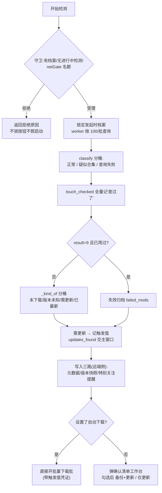

---

## 3.8 备份与恢复

### 功能说明

- `core/backupManager.py` —— 备份引擎:robocopy(/MT /XJ)复制 → 相对路径登记 → 保留策略(每 mod 份数 + 全局配额 + 钉住豁免);恢复走 R8 流程(恢复前强制先备份当前版本)。
- `core/backupRelocate.py` —— 备份根重定位的预演引擎:相对路径逐条对候选根数命中率,**0 命中禁认**。

### 代码片段与逐段注释

**片段① 备份的三道前提守卫 —— `core/backupManager.py:249-270`(节选)**

```python
        # ---- 前提一:本地版本必须已知(backups.version_timeupdated 非空)----
        # v2 判决制:version_unknown = confirmed_version IS NULL(单源取
        # Mod.version_unknown)。版本回填的正路 = 入账中心确认 / 右键
        # 「设定本地版本…」——旧版"扫描本地"路径已随判决制退役。
        if mod.version_unknown:
            if mod.status == "downloaded":
                error = ("本地版本未知:无法确定备份版本。\n"
                         "可到 mod 库页右键【设定本地版本…】人工认定版本后"
                         "再备份;或重新下载该 mod 并在收尾清单里确认入账。")
            else:
                error = ("该 mod 不是已下载状态(或版本未知):"
                         "备份只服务已下载且版本已确认的条目。")
            return BackupReport(ok=False, error=error)

        # ---- 前提二:确定备份根目录(档案值优先,缺省推导并回写)----
        root, derived = self._resolve_root(game)
        if root is None:
            return BackupReport(
                ok=False,
                error="无法确定备份位置:档案未设置备份目录,"
                      "且未配置 steamcmd 程序路径,无法自动推导。"
                      "请先在设置页填写 steamcmd 程序。")
```

**为什么这么写**:

- 版本未知拒绝备份是判决制的直接推论:备份目录名带版本号(`<modid>_v<版本>_<时间戳>`),版本是"确认值"(D14);给版本未知的东西做备份,恢复时会不知道回到哪一版——备份的价值全在可回滚,含糊版本等于没有备份。
- 错误文案**给正路**而不是只说"不行":右键设定版本 / 重新下载确认,两条补版本的路都指出来。
- "操作层面不成立"全部走 `BackupReport` 返回而不抛异常(方法 docstring):"id 查不到(调用方传错)按 bug 处理直接抛 ValueError;其余一切'操作层面不成立'(没内容、空间不够、拷贝失败)都通过报告返回——这些是需要向用户解释的情况,不是 bug。"

**片段② 复制与失败清理 —— `core/backupManager.py:312-328`(节选)**

```python
        # ---- 复制 ----
        # 版本号进目录名(<modid>_v<版本>_<时间戳>):v2 取确认版本
        # (守卫在上面保证了到这里必然非 NULL)
        dst = self._fresh_target(Path(root), mod_id, mod.confirmed_version)

        rc, out = self._run(str(source), str(dst))
        if not is_success_rc(rc):
            # 失败清理半成品(只在刚创建的备份根内动手,走 R4 保险丝)
            if dst.is_dir():
                try:
                    _safe_rmtree(dst, Path(root))
                except (RuntimeError, OSError):
                    pass
            return BackupReport(
                ok=False,
                error=f"robocopy 失败(退出码 {rc},≥8 才算失败):\n"
                      f"{out[-800:]}")
```

**为什么这么写**:

- robocopy 的退出码语义特殊:**0-7 都算成功**(1=拷了文件,2=有 extra,4=有不匹配……),≥8 才是失败——`is_success_rc`(`backupManager.py:103-107`)专门归一这个认知,直接 `rc != 0` 会把正常备份误判为失败。
- `runner` 注入口(`backupManager.py:214-215`):"默认真 robocopy;测试注入假的可测'拷贝失败回退',不需真制造失败"——引擎按次构造、参数注入,与 steamApiClient 同款模式。
- 失败清理限定在"刚创建的备份根内"(R4 保险丝参数 `_safe_rmtree(dst, Path(root)`)):删除永远带着"必须落在这个根内"的护栏,路径拼错也删不出根。
- robocopy 参数 `/MT /XJ`(/MT 多线程、/XJ 排除 junction 防链接环)在 `_run_robocopy` 里;mod 库动辄几 GB,多线程复制是刚需;XJ 防的是"备份目录树里有 junction"时复制器跟着链接跑出去的环。

**片段③ 恢复的不对称戒律 —— `core/backupManager.py:359-368`**

```python
    def restore_backup(self, backup_id: int) -> RestoreReport:
        """把一份备份恢复回下载目录。流程见文件头"恢复流程"(R8 原案)。"""
        # 恢复是覆盖性操作:steamcmd 在跑时直接拒绝。与备份只警告
        # (R7)不对称是故意的——备份顶多拿到不完整副本,恢复却会
        # 把写了一半的下载目录整个覆盖掉,两边一起坏
        if steamcmd_running():
            return RestoreReport(
                ok=False,
                error="检测到 steamcmd 正在运行:恢复会与下载争用同一目录,"
                      "请先退出 steamcmd 再恢复。")
```

**为什么这么写**:

- **备份警告 / 恢复拒绝的不对称**是 R7/R8 的分界:备份是读操作,撞上下载顶多副本不完整(有 warning 就够);恢复是写操作,会覆盖写了一半的目录,必须引擎级拒绝。风险等级不同,防线等级不同。
- R8 的另一半:恢复前**强制先备份当前版本**——恢复是"回到过去",但当前版本也许正是你想要的;强制留一版,恢复全程可退。

**片段④ 备份重定位:0 命中禁认 —— `core/backupRelocate.py:76-84`**

```python
def preview(candidate_root: str | Path,
            rel_paths: Iterable[str]) -> RelocatePreview:
    """预演:把相对路径逐条对到候选根上,数命中率。只读不写。"""
    root = str(candidate_root or "").strip().strip('"').strip()
    # 空串的 Path 是"."——绝不能让空输入碰巧对上当前工作目录
    root_exists = bool(root) and Path(root).is_dir()
    out = RelocatePreview(candidate_root=root, root_exists=root_exists)
    for rel in rel_paths:
        rel = str(rel or "").strip()
```

**为什么这么写**:

- 登记时存**相对路径**(R1,`backupManager.py:330-335`:"登记两段式相对路径 '<mod编号>/<目录名>'")正是为了让重定位便宜:搬家后把相对路径逐条对到新根上数命中率,命中率高才允许改档案的 backup_dir 指针。0 命中禁认(项目决策 29:"重定位 = 指认新根+命中率验证 0 命中禁认")防止指错根后所有备份"失联"。
- `空串的 Path 是"."` 的注释防一个隐蔽 bug:空输入碰巧对上当前工作目录,命中率会"全中"——先挡空串。

### 执行逻辑流程图

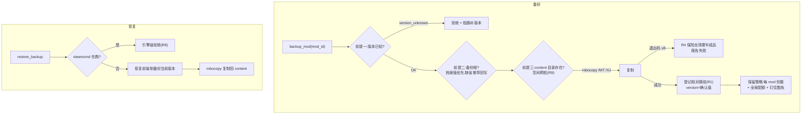

---

## 3.9 删除体系与防复活

### 功能说明

删除不是一锤子买卖,而是一个**动作清单编排器**(`workflows/deleteManageFlow.py`)+ 三个断根手段(`core/steamPaths.py`):

- 软删除(可恢复)/ 彻底清账(物理删除 + 拉黑 + 断根);
- 孤儿目录(盘上有、账本无)处置 + 防复活复合开关;
- 防复活三道防线:黑名单拦截入账、批前清缓存、acf 条目移除(断根)。

"复活"的机理(`steamPaths.py:165-170` 注释):steamcmd 把下载过的数据块缓存在 `depotcache\`、半成品暂存在 `steamapps\workshop\downloads\`;content 里的 mod 被删除后缓存还在,此后批次下载别的 mod 时,steamcmd 可能用缓存把已删除的 mod 原样装配回 content 并写回 acf——实测实证的现象,不是理论推测。

### 代码片段与逐段注释

**片段① 计划校验:动作必须落在盘点给过的行上 —— `workflows/deleteManageFlow.py:282-309`(节选)**

```python
def build_plan(repo: ModRepository, report: InventoryReport,
               req: PlanRequest) -> CleanupPlan:
    """把用户勾选校验、定序成动作清单。校验不过 → ValueError
    (消息可直接给用户看)。纯逻辑,可单测。"""
    missing_ids = {r.mod_id for r in report.missing_rows}
    clean_by_id = {r.mod_id: r for r in report.cleanable_rows}
    orphan_ids = {o.mod_id for o in report.orphans}

    # ---- 校验:每个动作都必须落在盘点给过的行上(不许凭空发明) ----
    for mid, act in req.ledger_actions.items():
        if mid not in missing_ids:
            raise ValueError(f"mod {mid} 不在「账有盘无」清单里,不能处置")
        if act not in ("soft", "purge"):
            raise ValueError(f"未知的账面动作:{act}")
    for mid, act in req.clean_actions.items():
        row = clean_by_id.get(mid)
        if row is None:
            raise ValueError(f"mod {mid} 不在「盘上可清」清单里,不能处置")
        if act == "wipe_soft" and row.status != "downloaded":
            raise ValueError(
                f"mod {mid} 状态为{row.status},没有「软删除」可做"
                "(已经是删除/失效状态)")
        if act == "wipe_purge" and row.status == "failed":
            raise ValueError(
                f"mod {mid} 是失效条目:处置链归异常页,本页只清文件")
```

**为什么这么写**:

- "不许凭空发明"是动作与盘点强绑定的校验:每个动作都必须能对应到盘点报告里的一行。页面状态可能已过时(用户开着旧盘点结果、另一边处置了同一个 mod),校验把"过期勾选"当场拦下,而不是让执行层删一个盘点时不存在的东西。
- 校验是**纯逻辑**(`build_plan` docstring),pytest 直接喂 `InventoryReport` + `PlanRequest` 就能测全部分支,不碰磁盘。
- `wipe_purge` 对 failed 条目拒绝并指路异常页:失效条目的处置链(重查/搜索/关联替换)在异常处置页,清理页只清文件——功能边界写进校验,避免两个页面抢同一条账。

**片段② 定序:防复活的方向性 —— `workflows/deleteManageFlow.py:380-383`(注释原文)**

```python
    # ---- 定序:拉黑 → 账本条目移除 → 账面 → 备份文件 → 账内目录 →
    # 孤儿文件。决定与断根放最前、重活最后:任何一处停下,残留方向
    # 永远是"拦路闸已上、文件还在"(无害可续行);反过来中途停下会
    # 留下"文件没了、引信还在"的复活窗口 ----
```

**为什么这么写**:

- 顺序不是随手排的,而是**失败方向性**论证:先上拦路闸(拉黑/断根),后干重活(删文件)。执行到一半停下(用户点停、磁盘错误),残留状态永远是"防复活闸已生效、文件还在"——安全,可重新执行续行;反过来的顺序会在中途留下"文件没了、引信还在"的窗口,是复活事故的温床。
- "批间停止绝不删一半"同样靠这个条间结构支撑:工作线程逐条执行动作,条间是天然的停止点。

**片段③ 执行层:拒绝穿透链接 + 逐条报告 —— `workflows/deleteManageFlow.py:506-545`(节选)**

```python
        if action.kind in ("content", "orphan"):
            target = Path(action.path)
            links = _find_links(target)
            if links:
                return ActionResult(
                    action.kind, action.mod_id, ok=False,
                    detail="目录树中发现链接/junction,拒绝删除:"
                           + "、".join(str(p) for p in links[:3])
                           + "——请先到「连接」指引处理拓扑,再回来清理")
            if not target.is_dir():
                return ActionResult(action.kind, action.mod_id, ok=True,
                                    detail="盘上本已不存在")
            safe_rmtree(target, Path(action.expected_root))
            tip = ("已删除;想回来重新下载即可(命令生成页勾选该编号)"
                   if action.kind == "content"
                   else "已删除(账本无记录,不可恢复)")
            return ActionResult(action.kind, action.mod_id, ok=True, detail=tip)
        if action.kind == "orphan_blacklist":
            repo.add_purged(action.mod_id, action.game_id,
                            note="孤儿处置拉黑")
            dropped = repo.drop_stale_claims(action.game_id,
                                             [action.mod_id])
            extra = (f";撤销未确认认领提案 {dropped} 条"
                     if dropped else "")
            return ActionResult(
                action.kind, action.mod_id, ok=True,
                detail="已列入已清账黑名单(本工具永不自动入账;"
                       "反悔走已清账管理·允许录入)" + extra)
```

**为什么这么写**:

- **删前先查链接**(`_find_links`):mod 目录树里可能有作者放的 junction/symlink;直接 rmtree 会穿透链接删到链接指向的外部目录。发现链接整个动作拒绝并指路——"目录树中发现链接/junction,拒绝删除"。这是联接红线(绝不穿透删除)在删除场景的执行。
- 拉黑动作顺带 `drop_stale_claims`:孤儿目录可能刚被盘点落过认领提案,拉黑后提案必须作废——否则待认领区里还躺着一条永远确认不成功的死提案。
- 一切"操作层面不成立"返回 `ok=False + detail` 不抛异常(`execute_action` docstring:"需要向用户解释的情况不是 bug"),工作线程逐条收集结果,批间停止点完整保留。

**片段④ 断根手术:acf 条目移除 —— `core/steamPaths.py:443-449`(docstring)与 `core/steamPaths.py:470-512`(节选)**

```python
    """从工坊账本文件(acf)里移除指定条目的登记。

    两个登记区块都要清:
    - WorkshopItemsInstalled = 本地安装事实(扫描的唯一读取源);
    - WorkshopItemDetails = steamcmd 上次联网的镜像缓存。
    只删 Installed 的话扫描拦得住入库,但 steamcmd 的"整体校验
    装配"仍可能从缓存把内容装回 content——两块一起删才算断根。

    返回 (实际移除的编号, acf 里本来就没有的编号)。

    文件级问题(读不了/解析失败/没有 AppWorkshop 根)→ ValueError,
    文件保持原样;一个条目都没删时不动文件、不产生备份。
    """
```

```python
    try:
        data = vdf.loads(text)
    except Exception as exc:
        # 解析不了就不写——绝不把可能损坏的文件写回去
        raise ValueError(f"acf 解析失败(文件损坏或不是 VDF 格式):{p}") from exc

    if not isinstance(data, dict) or not isinstance(data.get("AppWorkshop"), dict):
        raise ValueError(f"该文件没有 AppWorkshop 根区块(可能选错了文件):{p}")

    workshop = data["AppWorkshop"]
    blocks = (workshop.get("WorkshopItemsInstalled"),
              workshop.get("WorkshopItemDetails"))
    removed: list[int] = []
    absent: list[int] = []
    for mid in mod_ids:
        key = str(mid)  # acf 的键全是字符串形态的编号
        hit = False
        for block in blocks:
            if isinstance(block, dict) and key in block:
                del block[key]
                hit = True
        (removed if hit else absent).append(mid)

    if not removed:
        # 没东西可删:不写文件(少一次无谓的改动、不产生多余备份)
        return removed, absent

    # 备份先行:同目录、原文件名 + .bak_时间戳
    stamp = time.strftime("%Y%m%d_%H%M%S")
    backup = p.with_name(p.name + f".bak_{stamp}")
    shutil.copy2(p, backup)
    try:
        # pretty=True:嵌套块缩进换行,与 steamcmd 原生格式接近,
        # 人肉打开也好读;utf-8 无 BOM(steamcmd 自己写的 acf 就没 BOM)
        p.write_text(vdf.dumps(data, pretty=True),
                     encoding="utf-8", newline="\n")
    except OSError as exc:
        raise ValueError(f"acf 写回失败(原文件已备份在 {backup}):{exc}") from exc

    # 写回成功才清旧备份(keep=1,2026-10 拍板):写失败的路径走不到
    # 这里——刚建的备份安然无恙,是唯一的好账本
    _prune_acf_backups(p)
    return removed, absent
```

**为什么这么写**:

- **两个区块一起删**是断根的知识核心:只删 `WorkshopItemsInstalled` 拦得住扫描入库,但 steamcmd 的整体校验装配仍能从 `WorkshopItemDetails`(联网镜像缓存)把内容装回 content——删一半等于没断根。
- **解析不了就不写**:`except Exception` 后抛 ValueError 且文件保持原样。acf 是 steamcmd 的内部状态机快照,写坏它 = steamcmd 侧整个工坊状态不可知;宁可不手术,不能写回半残文件。
- **备份先行 + 写回成功才清旧备份**(keep=1):任何时刻盘上至少有一份"最近一次成功手术前"的原账;写失败路径不经过清理,刚建的备份与上一份都在,人工恢复有得选。
- 另一处安全设计在调用侧把关(注释 `steamPaths.py:415-416`):"steamcmd 是否在跑由调用方把关(它退出时会把内存里的旧账本整个覆盖写回,运行中改等于白改)"——`deleteManageFlow.py:372-375` 就按此跳过并提示事后到「已清账管理·清除残留」补做。

**片段⑤ 批前/批后清缓存 —— `core/steamPaths.py:188-214`(节选)**

```python
    root = steamcmd_root(steamcmd_path)
    if root is None:
        return 0, 0, []
    freed = 0
    cleared = 0
    skipped: list[str] = []
    for cache in (root / "depotcache",                     # 实测真身:安装根直下
                  root / "steamapps" / "depotcache",       # 兼容候选:旧认知位置
                  root / "steamapps" / "workshop" / "downloads"):
        if not cache.is_dir():
            continue
        if os.path.islink(str(cache)) or os.path.isjunction(str(cache)):
            skipped.append(str(cache))  # 本身是联接:不动(红线)
            continue
        for child in list(cache.iterdir()):
            size = _tree_size(child)
            try:
                if child.is_dir() and not child.is_symlink() \
                        and not os.path.isjunction(str(child)):
                    shutil.rmtree(child)
                else:
                    child.unlink()
                freed += size
                cleared += 1
            except OSError:
                skipped.append(str(child))
    return freed, cleared, skipped
```

**为什么这么写**:

- depotcache 的位置是**实测修正**的(注释 `steamPaths.py:172-178`):steamcmd 独立安装把 depotcache 放在安装根直下,不在 steamapps\ 下——此前引擎找错位置,目录不存在 → 每次静默空转,"没有缓存"的假阴性由此而来。现在两处候选都清:存在就清,不存在跳过。
- **content 一概不碰**(`steamPaths.py:169-170`):"content 一概不碰——受保护的资产,不是缓存。"清缓存只清装配材料,绝不触碰用户的 mod 文件。
- 占用文件逐项尝试、失败记入 skipped 清单跳过:**清理是优化,不是下载的前提**——绝不抛错、绝不阻塞批次(注释原文)。目录本身是联接则整体跳过(联接红线)。

### 执行逻辑流程图

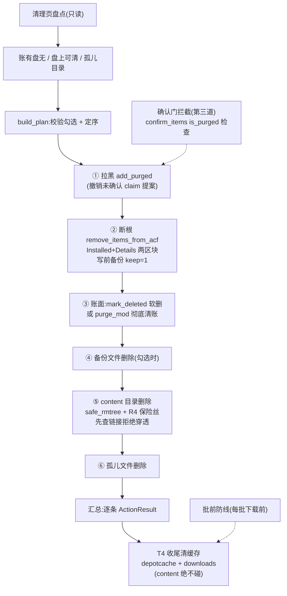

---

## 3.10 账实核验与连接巡检

### 功能说明

- `core/modVerifier.py` —— 两份对账,纯存在性检查:① 账本 ↔ content 磁盘(missing / empty / untracked_content / non_numeric);② 账本 ↔ 游戏侧链接(junction 巡检)。
- `core/steamPaths.py → junction_state` —— "游戏 mod 目录 ↔ 下载目录"十状态判定(连接指引对话框的唯一判定依据)。

核验页的哲学是**只做存在性对账**:文件在不在、目录空不空;不猜版本、不动文件。修复动作(重下/重下 validate/设为版本未知)全部要人点。

### 代码片段与逐段注释

**片段① 主对账:三差集 —— `core/modVerifier.py:103-157`(节选)**

```python
def verify(
        download_dir: str | Path | None,
        status_by_id: Mapping[int, str],
) -> VerifyResult:
    """对账主入口。

    download_dir:档案的 steamcmd 工坊内容目录(…/workshop/content/<appid>)
    status_by_id:{mod_id: 状态},调用方用 list_mods 取全后传字典
    (要含 deleted/failed——它们决定"盘上有目录"算不算异常)
    """
    if not download_dir:
        return VerifyResult(download_dir=Path(""), dead_root=True)
    root = Path(str(download_dir)).expanduser()
    if not root.is_dir():
        # 死根短路:不逐条报 missing(全是噪音),让 GUI 去走重推导流程
        return VerifyResult(download_dir=root, dead_root=True)

    numeric: dict[int, str] = {}   # 编号 → 目录名(保留原名,防前导零错位)
    non_numeric: list[str] = []
    for entry in root.iterdir():
        if entry.is_dir() and entry.name.isascii() and entry.name.isdigit():
            numeric[int(entry.name)] = entry.name
        else:
            # 非数字目录,以及 content 下不该出现的散文件——都进非数字桶
            non_numeric.append(entry.name)

    missing: list[int] = []
    empty: list[int] = []
    healthy = 0
    for mod_id, status in status_by_id.items():
        if status != "downloaded":
            continue
        name = numeric.get(mod_id)
        if name is None:
            missing.append(mod_id)
        elif _dir_is_empty(root / name):
            empty.append(mod_id)
        else:
            healthy += 1

    # 盘上有数字目录、账本却不是 downloaded:全部收进 untracked_content,
    # 状态原样携带(None = 不在库中),怎么解读交给 GUI
    untracked = [
        (mod_id, status_by_id.get(mod_id))
        for mod_id in numeric
        if status_by_id.get(mod_id) != "downloaded"
    ]
```

**为什么这么写**:

- **死根短路**:`download_dir` 不存在时不逐条报 missing——目录都没了,每条 downloaded 都"missing"全是噪音;一个 `dead_root` 标志让 GUI 去走重推导流程,信息量更高。
- "保留原名,防前导零错位"(`numeric` 字典的注释):目录名 `000123` 与账本编号 123 是同一 mod;字典双向保留原始名,展示时用原名,比对时用 int——两边都不出错。
- 调用方要传**全量状态**(含 deleted/failed):它们决定"盘上有目录"算不算异常——已删除的 mod 盘上有目录应进 untracked_content(复活线索),这个判定需要知道状态。
- `_dir_is_empty` 只看一层(`modVerifier.py:97-100`):mod 目录结构是作者定义的,深层有没有东西不影响"是否空目录"的判定;递归扫几万文件只为回答"空不空",成本不成比例。

**片段② junction 巡检:两种链接都要查 —— `core/modVerifier.py:200-251`(节选)**

```python
    # 单目录布局:游戏侧与下载目录指向同一处(斜杠方向、大小写差异
    # 不算不同)。合法布局——mod 实体就在游戏读取的目录里,不存在
    # 也不需要链接,逐条巡检只会把全部实体目录误报成"实为目录"。
    # 按未启用处理返回 None。放在存在性检查之前:目录真不存在时
    # 主对账(verify)已报死根,这里不必重复报
    if _same_path(root, content_root):
        return None
    if not root.is_dir():
        return JunctionResult(game_mod_dir=root, dead_root=True)
```

```python
        # junction 和符号链接都算"链接":对游戏完全等价。
        # islink 对 junction 返回 False,isjunction 对 symlink 也返回
        # False——只查一个就会把另一种误报成"实为目录"
```

**为什么这么写**:

- `islink`/`isjunction` **两查都做**是 Windows 路径的知识点:两个 API 互不识别对方,只查一个就会把另一种链接误报成"实为目录",巡检结论整个错掉。
- 单目录布局(游戏侧与下载目录同一路径)先排除:这是合法布局,逐条巡检只会把全部实体目录误报成异常——"检测通过才报事"的反面是"不适用就不报"。

**片段③ junction_state:反向拓扑与防环 —— `core/steamPaths.py:239-273`(docstring 摘录)**

```python
    """T13:判定"游戏 mod 目录 ↔ 下载目录"这对路径处于哪种联接状态。
    只读判定,不做任何修改。

    背景见连接指引对话框(gui/linkGuideDialog.py):部分游戏只从自己的
    目录读 mod,需要用 junction 把它和 steamcmd 的工坊内容目录接通。
    本函数是对话框唯一的判定依据;命令生成、文案分派都在对话框侧。

    支持两种拓扑(v2:实测用户环境存在反向拓扑后加入):
    - 正向:游戏 mod 目录是联接 → 指向下载目录(指引推荐的建法)
    - 反向:下载目录本身是联接 → 指向游戏 mod 目录——steamcmd 写入时
      经联接落到游戏目录,游戏直接读真实目录,同样成立

    反向检查必须排在"建议正向建链"之前,两个原因:
    一是把"已接通"误报成"需搬运"(v1 恰好在用户环境犯了这个错,
    而且照做等于对着同一份数据自己搬自己);二是游戏目录不存在、
    下载目录却是联接时,若仍建议 mklink 游戏→下载,会造出
    联接→联接 的环,NTFS 会照单全收,之后遍历就是无底洞。
    """
```

**为什么这么写**:

- 十状态判定(`JunctionReport`,steamPaths.py:216-235)把"已接通"的所有合法形态(正向/反向/半接)与各种异常形态一一枚举——对话框按状态分派文案与命令,判定逻辑单源在这一个函数里。
- "反向检查排前"的两个理由都是实测教训:误报"需搬运"会导致**对着同一份数据自己搬自己**;悬空反向链接时再建议 mklink 会造出联接环——NTFS 照单全收,之后遍历就是无底洞。判定顺序本身就是防事故设计。

### 执行逻辑流程图

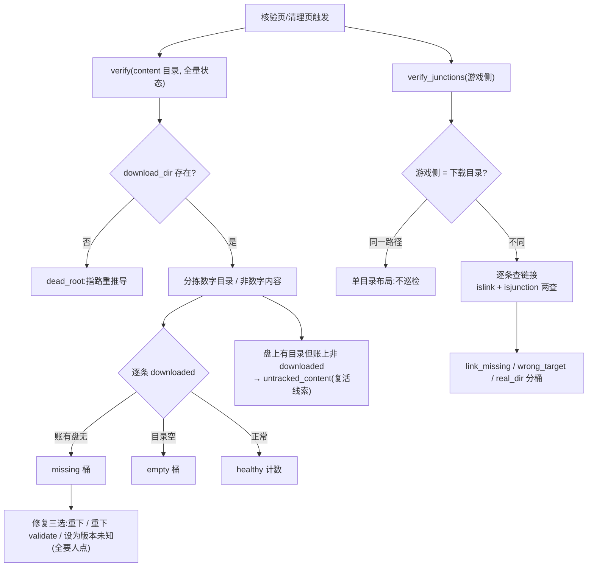

---

## 3.11 导入导出与旧账迁移

### 功能说明

双产品双语义(共享一份数据底座):

| 产品 | 格式 | 语义 |
|---|---|---|
| **账本备份(ledger)** | 全 8 表 JSON | 导入 = 清库重灌(确认弹窗默认"否") |
| **清单分享(sharepack)** | 单档案 JSON | 导入 = 增量并入(只补缺,不覆盖);机器侧字段剥离、downloaded → tracked |

`core/dataExporter.py` 负责构建/校验/导入;`core/legacyMigrate.py` 负责 V1 旧账本(旧 sqlite)一次性迁入。

### 代码片段与逐段注释

**片段① 分享包的变换规则 —— `core/dataExporter.py:116-146`(节选)**

```python
def build_sharepack(repo: ModRepository, app_id: int) -> dict:
    """某游戏的分享包 payload。数据路径刻意只有一条:整库经
    repo.export_all 倒出(repo 的唯一读取原语),在这里切片与变换
    ——repo 不为第二种产品单开读取口;user_version 顺路同源。
    变换规则(见文件头):只留本档案且 status ∈ {tracked, downloaded};
    downloaded → tracked;确认三件套与机器侧字段剥离。"""
    dump = repo.export_all()
    games = [g for g in dump["tables"]["games"] if g["app_id"] == app_id]
    if not games:
        raise ValueError(f"游戏档案 {app_id} 不存在")
    game_row = dict(games[0])
    for field in _SHARE_STRIP_GAME:
        game_row[field] = None
    mods: list[dict] = []
    for row in dump["tables"]["mods"]:
        if row["game_id"] != app_id or row["status"] not in _SHARE_STATUSES:
            continue   # 别家档案的、已删/已失效的:不外带
        row = dict(row)   # 拷贝再改,不污染 dump
        if row["status"] == "downloaded":
            row["status"] = "tracked"
        for field in _SHARE_STRIP_MOD:
            row[field] = None
        mods.append(row)
```

**为什么这么写**:

- **数据路径只有一条**(整库 export_all 后切片):repo 不为第二种产品单开读取口——读取原语越少,账本层越稳定;变换是纯数据操作,切片成本毫秒级。
- `downloaded → tracked` 的降级是判决制的必然:分享包里的"downloaded"是**你机器上的确认**,到别人机器上这份确认没有背书链条,落成"待下载"让对方自己下载+确认入账——版本事实不能随文件搬运。
- 剥离 `game_mod_dir / backup_dir` 等机器侧字段:这些是你的目录布局,对别人是噪音甚至毒数据(指向不存在的盘符)。
- `row = dict(row)` 拷贝再改:export_all 的产物在内存里还要给 ledger 用,直接改会污染原始 dump。

**片段② 导入三道关 —— `core/dataExporter.py:170-199`(节选)**

```python
def load(path: str | Path) -> dict:
    """JSON 文件 → payload,全量校验。三道关:
    ① 能不能解析(不是 JSON → ValueError);
    ② 头部(不是本工具的格式 / 格式版本太新 → ValueError 提示升级);
    ③ 逐行(缺身份字段 / 类型不对 → ValueError,指名道姓到
       "mods[17] 缺少必要字段 mod_id" 这个粒度)。
    通过三关的 payload 才允许进 import_*。"""
    text = Path(path).read_text(encoding="utf-8")
    try:
        payload = json.loads(text)
    except json.JSONDecodeError as exc:
        raise ValueError(f"不是有效的 JSON 文件:{exc}") from exc
    _check_header(payload)
    _check_tables(payload)
    return payload
```

```python
    ver = payload.get("format_version")
    if not isinstance(ver, int) or isinstance(ver, bool):
        raise ValueError("format_version 缺失或不是整数")
    if ver > FORMAT_VERSION:
        raise ValueError(
            f"文件由更新版本的程序导出(格式 v{ver},本工具支持到"
            f" v{FORMAT_VERSION}),请先升级本工具再导入")
```

**为什么这么写**:

- **格式版本太新 → 拒绝并提示升级**是导入的关键防线:旧程序读到新格式的字段只会静默丢数据;明确报"请先升级"比"导入成功但少了一半字段"负责任得多。
- 错误信息精确到 `mods[17] 缺少必要字段 mod_id` 的粒度:分享包是发给普通玩家的,报错必须能让对方截图问一句就定位。
- `isinstance(ver, bool)` 的排除又是 bool-is-int 子类的坑:`True` 是合法 int,不排除则格式版本校验可被布尔值穿透。

**片段③ 旧账迁移两道闸 —— `core/legacyMigrate.py:327-348`(节选)**

```python
def migrate_old_ledger(old_db_path: str | Path,
                       new_repo: ModRepository) -> MigrationReport:
    """把旧账本整体搬进 new_repo 指向的新库,返回搬运报告。
    前置两道闸(都在动手之前拦下,不做一半再后悔):
    1. 旧文件必须是旧世界的库(peek 鉴别);
    2. 新库必须空着——已有档案或待确认条目都算"不空"
       (mod 必然挂在档案下,查档案就够;待确认判决行没有外键
       约束,单独再查一遍)。
    搬运全程一个事务:翻译阶段出错抛异常回滚;写库阶段任何一行
    被数据库约束拒绝也整体回滚——新库绝不留半截账。"""
    report = MigrationReport()

    # ---- 闸 1:旧文件验明正身 ----
    info = peek_old_ledger(old_db_path)
    if not info.is_migratable:
        raise ValueError(
            f"「{info.path}」{info.summary()}——迁移只处理上一代工具的旧账本")
    # ---- 闸 2:新库必须是空的 ----
    if new_repo.list_games() or new_repo.pending_confirmations():
        raise ValueError(
            "目标账本不是空库(已有档案或待确认条目):迁移只能搬进"
            "空库。请先确认新工具指向的是一个全新的数据库文件")
```

**为什么这么写**:

- 两道闸**都在动手之前**:旧文件验明正身(peek 鉴别新旧世界)、新库必须空——不做一半再后悔。迁移是"把一代人的账搬进新家",半截账比不迁更糟。
- `peek` 的注释里有一个 sqlite 知识坑(`legacyMigrate.py:290-292`):"sqlite3.connect 是惰性的——连纯文本冒充的库文件也能'连上',要到第一条真正读文件的语句才炸 DatabaseError。所以'是不是库'的判断必须包住鉴别查询本身,不能只包 connect。"
- 迁移后的字段映射原则是"几乎同名直映"(项目决策 45):旧账的版本记录降级为 `inherited_acf`(来源"旧账",库页灰显)——旧账的版本没有终端判决背书,继承进新世系但如实标注;导入后收尾两步 = 扫描 + 跑一次检测。

### 执行逻辑流程图

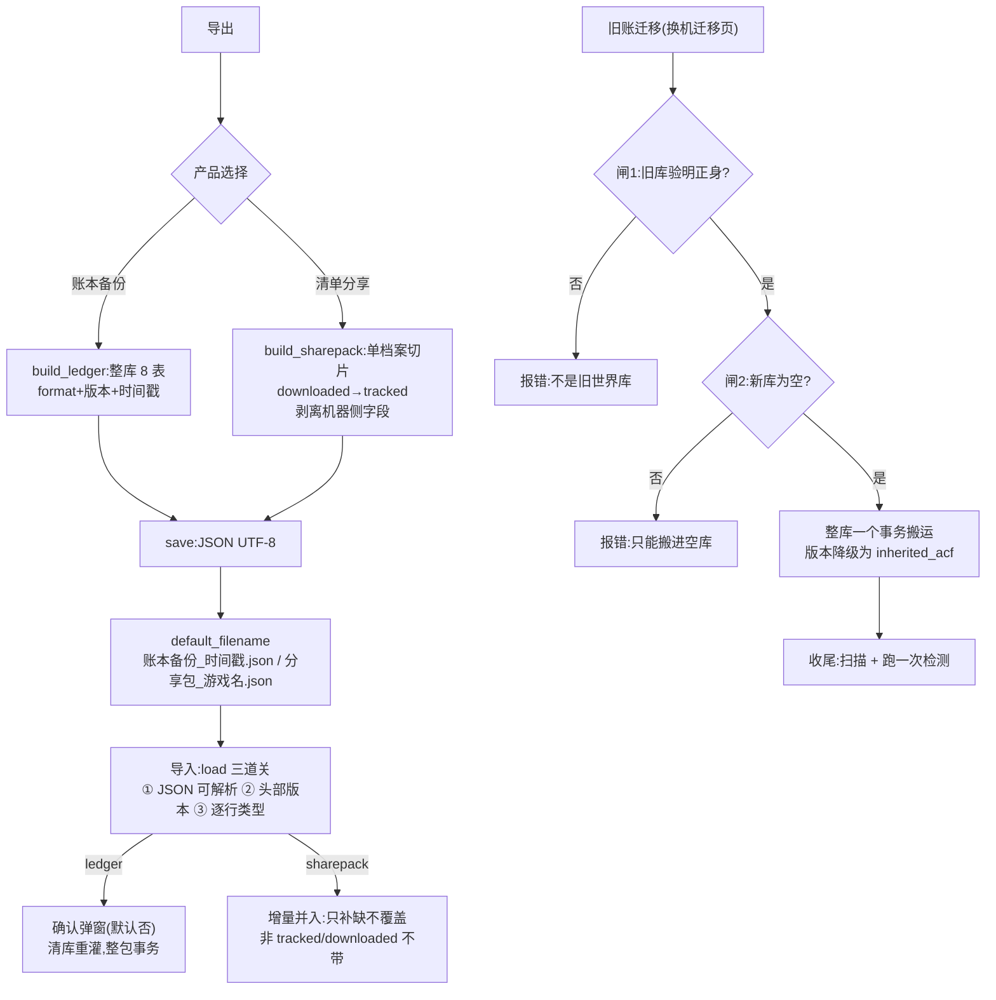

---

## 3.12 mod 描述与翻译

### 功能说明

工坊描述是一整段 BBCode(图片/视频/链接以标签内嵌正文,不是独立字段)。三件事共用同一个前提:先把 BBCode 拆成"文本块 + 链接块"的有序序列。

- `core/bbcodeParser.py` —— 解析与三种渲染(原文/译文/对照)的唯一实现;
- `core/translateProvider.py` —— 翻译通道:Edge 免鉴权(默认)/ Bing 网页(备选);
- `gui/translateWorker.py` —— 分段批量翻译线程(整批失败退回逐段救)。

### 代码片段与逐段注释

**片段① 剥壳留肉的容错铁律 —— `core/bbcodeParser.py:14-25`(文件头)与 `core/bbcodeParser.py:83-95`(节选)**

```python
"""
容错铁律(剥壳留肉):
    - 认识的标准标签转换:[img]URL[/img]、[youtube]/[video]、
      [url=…]文字[/url] → 链接行(零下载,点开浏览器看);
    - 其余一切标签剥壳留肉:[b]粗[/b] → 粗、[size=5]大[/size] → 大、
      [list][*]甲[*]乙[/list] → • 甲 • 乙——内容一个字不丢;
    - 纯文本里偶然的方括号("[哈哈]"、"[EOS R6]")不是标签,不动;
    - 作者贴进来的 HTML/尖括号在渲染边界全过 html.escape,只当字看。

块序即段序:
    译文分段数组(刀3 落库的 description_trans JSON)与 text 块按
    出现顺序一一对齐——对照态"第 N 段原文贴第 N 段译文"靠这个序,
    谁也不许私自重排。
"""
```

```python
def parse_description(raw: str | None) -> list[DescBlock]:
    """BBCode 原文 → 块序列。空描述/剥完是空的 → 空列表。
    两段策略:先 stash 再归位——认识的内嵌标签换成 \x00序号\x00 哨兵
    混进正文流,等文本清洗([*]→圆点、剥壳留肉、压空行)按空行切段
    后,再按哨兵原位插回链接块。顺序全程不乱。

    嵌套修复(2026-10 实证"□13□"方块 + 内容缺失):[url=X][img]U[/img]
    [/url](工坊常见的"图片带超链接")在 on_url 里拆解——内层图片块
    就地接管外层链接的点击目标,绝不让哨兵残留在任何显示文案里。
    出口另有净化兜底:任何未知路径漏进块文本的哨兵就地剥除——
    内部占位符永远不该抵达用户眼前。只动 link 块与残留净化,
    text 块序稳定——已落库译文(按 text 块序对齐)不受影响。
    """
    if not raw:
        return []
    s = raw.replace("\r\n", "\n").replace("\r", "\n")
    links: list[DescBlock] = []

    def stash(block: DescBlock) -> str:
        links.append(block)
        return f"\x00{len(links) - 1}\x00"
```

**为什么这么写**:

- **"剥壳留肉"**是容错哲学:BBCode 标签五花八门(字体/颜色/列表/表格…),逐个实现转换是永不收敛的军备竞赛;不认识的标签剥掉壳、留下内容,信息零丢失。
- **先 stash 再归位**的哨兵策略解决"图片视频链接混在正文里"的分段问题:内嵌内容替换成 `\x00序号\x00` 哨兵混进文本流,文本清洗(压空行、[*] 转圆点)完成后按哨兵原位插回链接块——文本段与链接块的顺序全程稳定,这正是"译文分段数组与 text 块一一对齐"的依赖。
- 裸链接(作者没包 `[url]` 的纯文本 URL)**刻意不在解析时转链接块**(`bbcodeParser.py:63-66`):"段结构一动,已落库的 description_trans 按旧段序的对齐就全错了"——渲染层 linkify 即可,解析层保持段结构稳定。

**片段② Edge 免鉴权通道 —— `core/translateProvider.py:62-71` 与 `core/translateProvider.py:113-132`**

```python
class EdgeProvider(BaseProvider):
    """微软 Edge 内置翻译通道(默认)。零 key 零 token:直 POST
    字符串数组即译,原生批量——一条描述通常一两次请求完成。
    非公开端点,改版风险与所有免费通道同级——失败文案给足指引。
    单段超长(>单请求字符上限)时该段单独成批,仍超限就让它失败
    (该段显示「⚠ 该段翻译失败」+原文)——工坊描述到不了这个量级。"""

    _URL = "https://edge.microsoft.com/translate/translatetext"
    _MAX_ELEMS = 50      # 单请求段数上限(保守值,后端实际更宽)
    _MAX_CHARS = 10000   # 单请求总字符上限(保守值)
```

```python
    def plan_batches(self, texts: list[str]) -> list[list[int]]:
        batches: list[list[int]] = []
        cur: list[int] = []
        chars = 0
        for i, t in enumerate(texts):
            n = max(len(t), 1)
            if cur and (len(cur) >= self._MAX_ELEMS
                        or chars + n > self._MAX_CHARS):
                batches.append(cur)
                cur, chars = [], 0
            cur.append(i)
            chars += n
        if cur:
            batches.append(cur)
        return batches

    def translate_batch(self, texts: list[str], target: str) -> list[str]:
        if not texts:
            return []
        return self._post(list(texts), target)
```

**为什么这么写**:

- 选 Edge 端点做默认通道的三个理由:零 key 零 token(不用用户注册任何东西)、原生批量(POST 字符串数组,一条描述一两次请求)、无需令牌会话(对比 Bing 网页通道要先 GET 页面取 cookie+token,且实测部分环境整批 400)。代价是"非公开端点,改版风险与所有免费通道同级"——风险用失败文案给足指引来对冲,不假装修理它。
- `plan_batches` 返回**段下标分组**而不是切好的文本:worker 按下标把译文放回原位,段序对齐永远由下标保证。
- 基类默认实现(一段一组、循环单段)让不支持批量的通道(Bing)自动退化——worker 的批量循环只认 `plan_batches / translate_batch / translate` 三个动词,零特殊分支(`translateProvider.py:42-45`)。

**片段③ 整批失败退回逐段救 —— `gui/translateWorker.py:61-98`(节选)**

```python
    def run(self) -> None:
        total = len(self._segments)
        out: list[str | None] = [None] * total
        done = 0
        last_err = ""
        try:
            provider = make_provider(self._provider_name,
                                     cancel_event=self._cancel)
            for idxs in provider.plan_batches(self._segments):
                if self._stop_requested:
                    self.stopped.emit()
                    return
                batch = [self._segments[i] for i in idxs]
                got = self._attempt(
                    lambda b=batch: provider.translate_batch(b, self._target))
                if isinstance(got, TranslateProviderError):
                    last_err = str(got)
                    # 整批失败 → 逐段救(一次重试,保单段容错):
                    # 通道真死时每段都会快速失败,不会干等
                    for i in idxs:
                        if self._stop_requested:
                            self.stopped.emit()
                            return
                        one = self._attempt(
                            lambda t=self._segments[i]:
                            provider.translate(t, self._target),
                            retries=1)
                        if not isinstance(one, TranslateProviderError):
                            out[i] = one
                else:
                    for i, r in zip(idxs, got):
                        out[i] = r
                done += len(idxs)
                self.progress.emit(done, total)
                if done < total and self._interval_ms > 0:
                    if self._cancel.wait(self._interval_ms / 1000):
                        self.stopped.emit()
                        return
        except Exception as exc:  # 兜底:任何意外按失败收场,不炸主线程
            self.failed.emit(f"翻译线程异常:{exc}")
            return
```

**为什么这么写**:

- **整批失败退回逐段救**是多救一段是一段:通道抖动时整批可能只有一段超限,逐段重试(只一次,防干等)把可救的段都救回来;真通道死时每段快速失败,不会卡住——两个方向的代价都被约束住了。
- 译文数组 `[None] * total`:失败段保持 None 落库("null=该段失败",schema 语义),对照视图显示"⚠ 该段翻译失败"+原文——部分成功如实呈现,不整单作废。
- 与 RemoteQueryWorker 同族的停止语义:"停止 = 什么都没发生(已翻的段不落,收 stopped)"——落库由接收信号的主线程统一做,线程本身不写库不碰 UI。

### 执行逻辑流程图

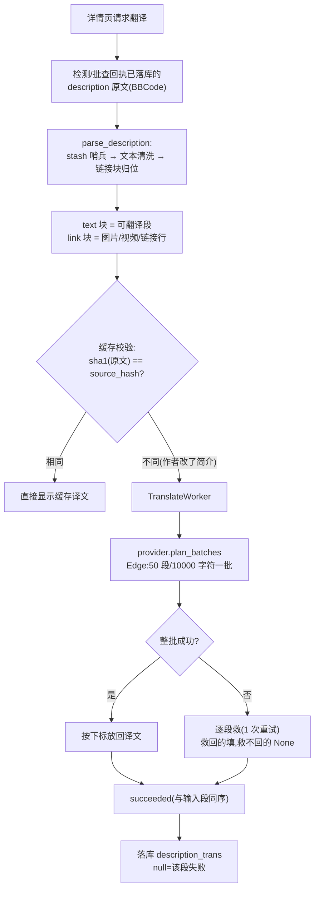

---

# 四、常见问题

以下条目均以源码实现与项目实测记录为依据(出处随手标注)。

## 4.1 需要 Steam 账号吗?会顶掉我的客户端登录吗?

下载需要登录**拥有该游戏**的账号(steamcmd 登录一次后本机缓存)。steamcmd 与 Steam 客户端是单点登录:登录 steamcmd 会把客户端顶下线,属正常现象。终端页有一行常驻灰字提示(`terminalDock.py:269-272`):"steamcmd 与 Steam 客户端同一账号只能登一处,后登录的会把先登录的顶下线"。日志里若出现 `result 1 (OK)` 的断线提示,是旧会话被本次登录挤掉的无害提示(`outputAnalyzer.py:193-199`),不是故障。

## 4.2 更新检测总失败,是不是把数据写坏了?

不会。检测失败只影响"这次没查成",**不写任何账面数据**——检测只写远端侧,失败时连远端侧也不写(`remoteQueryWorker.py`:"停止 = 什么都没发生")。网络不畅时看运行日志:重试是可见的(`steamApiClient.py:388-392`),日志会打"Steam 请求失败(第 N/M 次)…秒后自动重试(**不是卡死,是在重试**)"。常见根因是本机证书链(`CERTIFICATE_VERIFY_FAILED` ≠ Steam 拒绝),工具已用 truststore 走系统证书库(`steamApiClient.py:55-57`);若仍失败,检查代理/加速器对 `api.steampowered.com` 的处理。

## 4.3 下载报 Timeout 怎么办?

超时是 steamcmd 自己判的(不是本工具猜的),多数是 Steam CDN 在你所在区域的内容同步延迟,通常数小时到一两天自愈。可做:

1. 等 CDN 同步后重跑(卡片上的【重试失败与超时条目】一键重跑);
2. 打开「下载前后清理缓存」开关(默认开,`appSettings.py:84-88`):删除过 mod 的场景更易复现,清缓存是 RimSort 同款对策;
3. 用核验页修复三选里的 **validate 重下**(只补缺失/损坏文件;注意它会把用户改过的文件冲回原版,`commandBuilder.py:91-97`)。

工具不做"超时判死":大 mod 下载几小时正常,强行判死会误杀(`batchDownloadFlow.py:51-53`);真卡死用【停止 steamcmd】兜底。

## 4.4 删掉的 mod 怎么又出现了?

steamcmd 的下载缓存会把已删除的 mod 重新装配回硬盘并写回 acf——实测实证(见 3.9)。工具默认三道防线在岗:

| 防线 | 时机 | 落点 |
|---|---|---|
| ① 彻底清账自动拉黑 + acf 断根 | 清账时 | `deleteManageFlow.build_plan` 定序(拉黑 → 断根 → 删文件) |
| ② 批前/批后清缓存 | 每批下载前/后 | `steamPaths.clear_download_caches`(depotcache 真身在安装根直下,实测修正) |
| ③ 确认门黑名单拦截 | 任何入账路径 | `confirm_items` / 开批入口硬拒 |

若它出现在**别的工具**(如 RimSort)的清单里被对方重新下载,请先把那边清掉——同一个游戏不要交给两个管理器(见 4.7)。

## 4.5 备份页说"版本未知,拒绝备份"?

备份目录名带版本号,版本必须是"你确认过的值"。版本未知的补正路:`mod 库页右键【设定本地版本…】人工认定`,或重下后在收尾清单确认入账(`backupManager.py:253-257` 错误文案即此)。旧版"扫描本地反推版本"的路径已随判决制退役。

## 4.6 "已下载"的 mod 在游戏里看不到?

先跑核验页(3.10):

- **missing(账有盘无)**:content 目录下文件夹没了——修复三选重下;
- **empty(空目录)**:下载半残——validate 重下;
- 游戏侧问题 → 连接巡检页:游戏 mod 目录 ↔ 下载目录的 junction 十状态判定,按指引建链(注意反向拓扑已支持,别把"已接通"当"需搬运")。

## 4.7 能和 RimSort 等其他管理器一起用吗?

软件可以共存,但**同一个游戏不要两边同时管**(`readme.md:98,128-129`):两边各记各的账、互不知情,会出现删了的 mod 被对方下回来、按它的记录催更、版本来回拉扯。不同游戏各用各的没有问题。同理,用本工具管理的游戏不要再在 Steam 客户端里订阅同样的 mod。

## 4.8 双击启动没反应/提示"程序已在运行"?

工具带单实例锁(3.1):同一代只允许一个实例,防止两边同时指挥 steamcmd、同时写同一本账。锁文件在系统临时目录(`SteamWorkshopModAssistantV2.single-instance.lock`);异常断电残留的锁文件可手动删除后重启。

## 4.9 启动弹"无法启动:数据目录不可写"?

你把软件放进了 Program Files / Windows 等系统目录,普通权限进程没有写盘资格。工具**拒绝启动而不是悄悄把数据挪去 %APPDATA%**(便携模式的价值就在"数据位置永远可预期",`appPaths.py:18-21`)。按弹窗指引把整个软件文件夹移到普通目录即可。

## 4.10 会话记忆(列宽/折叠/主题)丢了?

会话记忆存在软件文件夹内 `config\` 下的 ini(决策 70),不再写注册表。丢失通常是这两种情况:

1. **改了组织名/应用名**——那是存储坐标,不是显示名,"改了会话记忆静默搬家/丢失";
2. 整个 config 文件夹被删。换机迁移时拷贝整个软件文件夹,记忆随行。

## 4.11 打开旧数据库报"上一代工具的旧账本"?

新世系库必须有 `verdict_log` 标记表;程序拒绝静默错读(3.2 片段④)。正路是「换机迁移」页的**旧账迁移**(3.11):旧账版本降级为 `inherited_acf` 继承,迁移后跑一次扫描 + 检测。

## 4.12 杀毒软件报毒?

PyInstaller 打包的免费软件偶被误报,属已知问题(`readme.md:134-135`);不放心可从源码运行(本仓库 MIT 开源)。打包命令与版本号两处同源核对(`version.txt` 与 `main.py` 的 `setApplicationVersion`)。

## 4.13 字号能调吗?

设置页「界面字号缩放」(80~200 建议,100=默认,重启生效)。全局字体与样式表字号共用同一把缓存尺(`theme._font_scale`),不会出现"字大了布局没跟"的错位。

---

# 五、附录:总架构 mermaid 图

## 5.1 分层依赖闸

`core`(纯逻辑零 Qt,17 件)← `workflows`(纯逻辑引擎,可 pytest)← `gui`(PySide6 壳)。依赖只允许**自上而下**,core 绝不 import gui——这是 pytest 能覆盖 core/workflows 的结构性保证,GUI 靠启动冒烟。

## 5.2 模块调用关系总图

```mermaid
flowchart TB
    subgraph GUI["gui 层(PySide6 壳)"]
        MAIN["main.py 启动序列<br/>锁/守卫/会话/主题"]
        MW["MainWindow(29 页导航)"]
        TD["terminalDock<br/>ConPTY 终端"]
        BDC["batchDownloadController<br/>收尾链编排"]
        UCP["updateCheckPage<br/>更新检测"]
        ACP["accountCenterPage<br/>入账中心四区"]
        BP["backupPage / backupOverviewPage"]
        DP["deletePage 清理页"]
        VP["verifyPage 核验页"]
        MP["migrationPage 换机迁移"]
        DP2["modDetailPanel 详情面板"]
        RQW["remoteQueryWorker<br/>批查询线程(三页共用)"]
        TW["translateWorker 翻译线程"]
    end
    subgraph WF["workflows 层(纯逻辑引擎)"]
        REG["registerFlow 登记五桶"]
        INV["inventoryFlow 只读盘点"]
        DMF["deleteManageFlow 删账编排"]
        EXF["exceptionFlow 三分类器"]
        AMF["addModFlow / intakeFlow<br/>gameExitFlow / uninstallFlow"]
    end
    subgraph CORE["core 层(纯逻辑零 Qt)"]
        SCHEMA["schema.sql + models<br/>11 表 + dataclass"]
        REPO["sqliteRepository<br/>★确认门 confirm_items"]
        URL["urlParser 解析三形式"]
        CB["commandBuilder 命令生成"]
        API["steamApiClient<br/>匿名+keyed,重试单源"]
        OA["outputAnalyzer 输出判决"]
        BDF["batchDownloadFlow 状态机<br/>resolve_written"]
        BM["backupManager robocopy"]
        SP["steamPaths<br/>junction/清缓存/acf 手术"]
        ACF["acfParser 盘面版本"]
        VER["modVerifier 两份对账"]
        DE["dataExporter ledger/sharepack"]
        LM["legacyMigrate 旧账迁移"]
        BB["bbcodeParser BBCode 剥壳"]
        TP["translateProvider Edge 通道"]
        NG["netGate 联网互斥闸"]
        SET["appSettings / appPaths<br/>settings / paths"]
        CONST["constants 一级单源"]
    end

    MAIN --> MW
    MAIN --> SET
    MW --> TD & BDC & UCP & ACP & BP & DP & VP & MP & DP2
    TD -->|"verdict_emitted / idle_prompt_seen"| BDF
    BDF -->|"send_command 注入"| TD
    BDC --> BDF
    BDC -->|"record_verdicts / drop_stale_claims"| REPO
    BDC --> OA
    BDF --> OA
    UCP --> API
    UCP --> REPO
    UCP --> EXF
    UCP --> NG
    RQW --> API
    RQW --> NG
    ACP --> REG
    ACP --> INV
    REG --> REPO
    INV --> REPO
    INV --> ACF
    ACF --> SP
    BP --> BM
    BM --> REPO
    BM --> SP
    DP --> DMF
    DMF --> REPO
    DMF --> SP
    DMF --> VER
    VP --> VER
    VP --> SP
    MP --> DE
    MP --> LM
    LM --> REPO
    DE --> REPO
    DP2 --> BB
    TW --> TP
    TW --> REPO
    EXF --> REPO
    ACF --> INV
    TD --> SP
    AMF --> REPO
    AMF --> CB
    MW --> CB
    URL --> REG
    CONST --> REPO
```

## 5.3 判决数据流(一张图背下来)

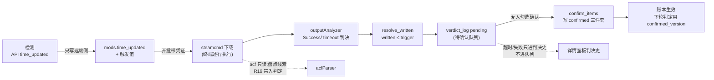

---

## 附:本文档的代码出处速查

| 章 | 片段 | 位置 |
|---|---|---|
| 2 | 启动守卫/单实例锁 | `main.py:99-116` |
| 3.1 | app_root / writability_problem | `core/appPaths.py:29-42, 74-103` |
| 3.1 | 设置 load/save 原子写 | `core/appSettings.py:110-133, 151-157` |
| 3.1 | 会话落点 | `gui/sessionStore.py:52-63` |
| 3.1 | 字号缩放 | `gui/theme.py:139-155` |
| 3.2 | mods 表 / verdict_log | `core/schema.sql:35-57, 90-115` |
| 3.2 | version_unknown / Verdict | `core/models.py:72-78, 90-107` |
| 3.2 | 开库三分支 | `core/sqliteRepository.py:112-142` |
| 3.2 | confirm_items / claim_accept / drop_stale_claims | `core/sqliteRepository.py:977-1056, 1058-1101, 958-975` |
| 3.3 | 正则与解析 / 挖除 | `core/urlParser.py:44-63, 84-101` |
| 3.3 | group_mods / build_copy_text | `core/commandBuilder.py:38-76, 84-88` |
| 3.4 | _request_json / query_details_keyed | `core/steamApiClient.py:364-425, 331-361` |
| 3.4 | netGate 三件 | `core/netGate.py:26-62` |
| 3.4 | RemoteQueryWorker.run | `gui/remoteQueryWorker.py:82-120` |
| 3.5 | ConPTY 理由 / send_command / shutdown | `gui/terminalDock.py:7-20, 311-329, 337-357` |
| 3.5 | 判决边界 / classify_line / is_idle_prompt | `core/outputAnalyzer.py:34-46, 141-163` |
| 3.5 | start / stop / resolve_written | `core/batchDownloadFlow.py:170-200, 121-132` |
| 3.5 | 收尾链 | `gui/batchDownloadController.py:554-613` |
| 3.6 | classify_register / apply_register | `core/registerFlow.py:55-89, 111-147` |
| 3.6 | scan_game | `core/inventoryFlow.py:57-141` |
| 3.6 | workshop_versions | `core/acfParser.py:85-106` |
| 3.6 | receive_ids | `gui/accountCenterPage.py:536-560` |
| 3.7 | _start_check / _kind_of | `gui/updateCheckPage.py:332-379, 434-446` |
| 3.7 | classify_dependencies / classify_health | `workflows/exceptionFlow.py:370-405, 287-336` |
| 3.8 | 备份守卫 / 复制 / 恢复 | `core/backupManager.py:249-270, 312-328, 359-368` |
| 3.8 | 重定位预演 | `core/backupRelocate.py:76-84` |
| 3.9 | build_plan / 定序 / execute_action | `workflows/deleteManageFlow.py:282-309, 380-383, 506-545` |
| 3.9 | remove_items_from_acf / clear_download_caches | `core/steamPaths.py:443-512, 188-214` |
| 3.10 | verify / verify_junctions / junction_state | `core/modVerifier.py:103-157, 200-251`;`core/steamPaths.py:239-273` |
| 3.11 | build_sharepack / load / 迁移两道闸 | `core/dataExporter.py:116-146, 170-199`;`core/legacyMigrate.py:327-348` |
| 3.12 | parse_description / EdgeProvider / worker | `core/bbcodeParser.py:14-103`;`core/translateProvider.py:62-132`;`gui/translateWorker.py:61-98` |


